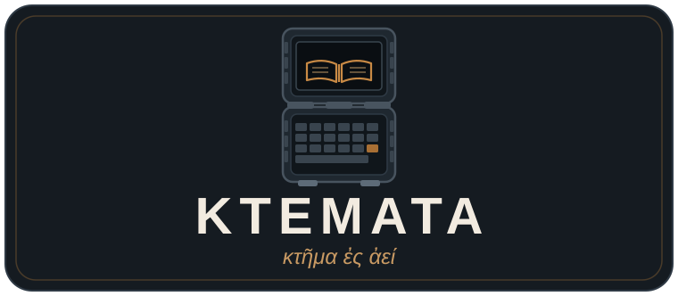

<p align="center">
  
</p>

# Ktemata

A rugged offline-library handheld (Pi 5, Touch Display 2, 2S 18650 UPS). Parametric OpenSCAD case; keeps Wikipedia, maps and Gutenberg when power and networking are gone.

## Ktemata

*Ktemata* (κτήματα) is Greek for "possessions, things owned" — the plural of *ktema*.
Thucydides opens his *History of the Peloponnesian War* by calling his work **κτῆμα ἐς ἀεί**, "a possession
for all time": written down not to win a prize for one hearing, but so that what happened stays available to
whoever comes later. That is this device's job. When the grid, the network and the servers are gone, it still
holds a library — Wikipedia, maps, the Gutenberg books, the medical and prepper references — in a rugged case
you can carry. The phrase is engraved on the face, and `KTEMATA` is the wordmark.

The r1 geometry was rebuilt from the photos in `Pi_Flux_r1_-_Build_Guide.pdf`. The guide has no CAD
drawings, so this is a **functional re-creation**, not a copy of the original files. The **r4** build is the
current target and the default CAD: Raspberry Pi Touch Display 2 (5"), Waveshare UPS HAT (B) with 2× 18650,
and the Rii K06 keyboard with touchpad. r2/r3 (DFR0550-V2 + UPS HAT (E) + 4× 21700 + Phistone) and r1 remain
selectable. Everything is parametric OpenSCAD: measure your own parts, edit `cad/common.scad`, then
re-export.

## Files

### Build variants

| Build | Mechanics | Keyboard / radios |
|---|---|---|
| **r1** | Original reverse-engineered Waveshare 5" DSI + INIU power bank case; r1-only pull switch and battery button | Original r1 keyboard; no r2 electronics |
| **r2** | Pi 5 + DFR0550-V2 + UPS HAT (E) + 4× 21700; same geometry and STLs as r3 | Wired USB keyboard; optional Pimoroni trackball; Wi-Fi/Bluetooth off |
| **r3** | Same mechanical build and STLs as r2 | Phistone Mini Keyboard (2.4 GHz USB dongle or Bluetooth 5.0); no Pimoroni trackball; Wi-Fi off |
| **r4** | **Current target and default CAD:** Pi 5 + Touch Display 2 (5", landscape) + UPS HAT (B) with 2× 18650 (2S); 172 × 237 × 53 mm | **Rii K06** 151 × 59 × 11 mm, 2.4 GHz dongle or Bluetooth; touchpad replaces the trackball; no Wi-Fi |
| **r5** | Same electronics as r4, **no air-quality sensor**; no printed exterior: an internal cassette (tray + deck + lid plate) drops into a bought Peli 1200, display on the inside of the lid | K06 on the deck; see [`docs/R5.md`](docs/R5.md) |

The default CAD is the **r4 build**. Two switches in `cad/common.scad` select the others: `R4` (`true`,
the default) turns the r4 retarget off, and `R2` (`false`) selects the original r1 case. `R5`
(`-D R5=true`, or `export.py --r5`) switches to the internal-cassette build, which needs the r4
mechanics and a host hard case (`HOST` = `"1200"` by default). **The Peli R40 proposed for r5 cannot
host the build** — its whole interior (48.3 mm) is shallower than the display plus the cell stack; see
[`docs/R5.md`](docs/R5.md) for the measurements and for the cases that do fit.

```bash
python3 cad/tools/export.py           # r4 parts (default)
python3 cad/tools/export.py --r2      # r2/r3 parts (DFR0550 + HAT (E) + Phistone)
python3 cad/tools/export.py --r1      # original r1 set
python3 cad/tools/export.py --r5      # r5 cassette (tray, deck, lid plate)
openscad -D R4=false -o out.png cad/assembly.scad      # r2/r3 assembly preview
openscad -D R2=false -o out.png cad/assembly.scad      # r1 assembly preview
```

The r1 parts are still in the repository and export with `export.py --r1`. r3 is a keyboard/radio variant of
r2 and shares its STLs (see [`docs/R3.md`](docs/R3.md)); r4 has its own geometry because the display, the
power board, the cells and the keyboard all changed (see [`docs/R4.md`](docs/R4.md)). Making r4 flatter is
analysed — and deliberately not done — in [`docs/SLIMMING.md`](docs/SLIMMING.md). Cast soft-rubber corner
caps with [`docs/CORNER_MOULD.md`](docs/CORNER_MOULD.md) (a retrofit accessory; the case STLs are unchanged).

| STL (`stl/`) | Source (`cad/`) | Print orientation | r4 |
|---|---|---|---|
| `ktemata_bottom.stl` – back shell | `bottom.scad` | back plate down, no supports | yes |
| `ktemata_face.stl` – front face | `face.scad` | face plate down | yes |
| `ktemata_keyboard_support.stl` | `keyboard_support.scad` | flat | yes |
| `ktemata_charge_plug.stl` – sealed charge plug | `charge_plug.scad` | flange down (TPU) | yes |
| `ktemata_corner_{cap,cup,plate,lid}.stl` – silicone corner overmould | `corner_mould.scad` | as exported | accessory |
| `ktemata_pull_switch.stl` – USB-C U-adapter pull switch | `pull_switch.scad` | top face (ring tab) down | r1 only |
| `ktemata_power_button.stl` – battery button plunger | `power_button.scad` | cap end down | r1 only |

`cad/assembly.scad` shows everything with stand-in components (`-D EXPLODE=40`).
`-D 'CHECK="bottom:pi"'` intersects one part with another, which is handy for clearance checks.
To re-export the STLs: `python3 cad/tools/export.py` (use `--r2`, `--r1` or `--r5` for the other sets).
To refresh the images in `renders/` afterwards: `python3 cad/tools/render.py` (add `--r1` to include the r1-only views;
the previews follow whatever is in `stl/`, so export the set you want rendered).
`R1=1 bash work/scripts/check.sh` runs the old interference set; the default is the r4 set
(`R4=0` for the r2/r3 pairs).

### Hand crank generator (separate project)

The backup charger is a **separate unit**, not part of the case: a 3:1 geared axial-flux alternator,
180 x 126 mm footprint, 68 mm tall. It was developed in this repository but now lives in its own
project, **<https://github.com/jsoeterbroek/handcrank>** — CAD, docs, STLs, renders and history.
Its output feeds the same sealed charge port as the solar panel (see `WIRING.md`).

## Shopping list / BOM

See [`BOM.md`](BOM.md) for the r3 shopping list (Kiwi Electronics primary, with Tinytronics / Robotshop /
Bol alternates). It excludes the FireBeetle 2 ESP32-UE, the 1.3" OLED and the already-owned r3 Phistone
keyboard, and flags the current display / UPS / NVMe / button fit caveats. The r2 wired-keyboard variant
uses the same list with the keyboard alternatives in its section C.

## Hardware alternatives

Thinking of using a Waveshare PocketTerm35 as a parts donor for the screen/keyboard/MCU? See
[`docs/POCKETTERM35-FEASIBILITY.md`](docs/POCKETTERM35-FEASIBILITY.md). Short version: not a good donor for
the 5" r2 design, but the RP2040 USB keyboard is the one part worth prototyping separately.

## Wiring

See [`docs/WIRING.md`](docs/WIRING.md) for the power and data/I²C block diagrams, pin-level tables and wiring
rules. It also links the editable KiCad 10 schematic (`docs/ktemata_r3_wiring.kicad_sch`, PDF/SVG/PNG) and
the netlist-style [`docs/ktemata_r3_connections.csv`](docs/ktemata_r3_connections.csv).

To prepare a fresh Ubuntu / Raspberry Pi OS install — system update, Kiwix, the ZIM library and the display
rotation — run [`work/scripts/post-install.sh`](work/scripts/post-install.sh); notes in
[`docs/POST_INSTALL.md`](docs/POST_INSTALL.md).

## ZIM library (Kiwix)

The offline content lives on the external disk (`/run/media/joost/data/zim`), listed in
[`zim/zim.md`](zim/zim.md). Check what is actually there, verify it, and keep the list in sync:

```bash
.venv/bin/python work/scripts/zim.py              # table: title, date, languages, entries, size
.venv/bin/python work/scripts/zim.py --check      # verify every checksum (slow)
.venv/bin/python work/scripts/zim.py --missing    # listed, not on disk
.venv/bin/python work/scripts/zim.py --update-list  # rewrite zim/zim.md from the disk
```

It reads the archives with **libzim** (prebuilt wheel, no compiler) and never writes to a
`.zim`. ZIM files themselves are git-ignored.

## Python environment

```bash
uv venv --python 3.13 .venv
uv pip install -r packages_development.txt   # or packages.txt for runtime only
source .venv/bin/activate
```

`packages.txt` holds the runtime dependencies (Pillow, for `work/scripts/crop.py`); `packages_development.txt`
adds PlatformIO, its `intelhex` runtime dependency and ruff. The export/render helpers are stdlib-only and just shell out to `openscad`.

## Status OLED firmware

`firmware/` is a PlatformIO project for the DFRobot FireBeetle 2 ESP32-UE
(N16R2, DFR1140). It drives the 1.3" 4-pin I2C OLED (SH1106/SSD1306), reads the
BME688, DS3231 and Waveshare UPS HAT (E) over I2C, and sends telemetry to the
Pi over USB serial. See `firmware/README.md` for the pinout, serial protocol
and current limitations.

```bash
source .venv/bin/activate
cd firmware
pio run                 # build
pio run -t upload       # flash over USB-C
pio device monitor      # 115200 baud
```

**Bring-up status:** the FireBeetle and 1.3" 4-pin SH1106 OLED are **working**
at `0x3C`; the display shows time/date and `BAT --` until the UPS HAT is
connected. I2C is SDA **GPIO21** / SCL **GPIO22** — the pins marked `21/SDA`
and `22/SCL`. Still to wire: button GPIO4, DS3231 `0x68`, BME688
`0x76/0x77`, UPS HAT (E) `0x2D`, and the PBS-33B button GPIO4→GND. The Pi-side serial sender for time/storage is
not written yet. Idle blanking is currently disabled (`-DSCREEN_OFF_MS=0UL`)
because the button is not fitted; the earlier blank screen was the OLED
display-off command, not an ESP32 sleep. Set it to `60000UL` when the button
works.

Without a DS3231 the clock resets on power loss; set it with (serial monitor
stopped):

```bash
printf '{"cmd":"time","epoch":%s}\n' "$(date +%s)" > /dev/ttyUSB0
```

The example sends a **UTC** epoch (`date +%s`); the FireBeetle converts it to
`TIMEZONE` (default Europe/Amsterdam, with DST) only for the OLED. Change
`TIMEZONE` in `firmware/include/config.h` for another region.

## Rugged exterior

The corner bumpers stand 3 mm proud. The body edges have a 3 mm 45° chamfer on the front and back, and the
left and right grip zones carry vertical ribs. The face has bevelled windows and faux screw heads over the
case screws. Everything prints without supports. To tune it, edit `BUMP*`, `EDGE_CZ`, `RIB_*` and `RIB_ZONES`
in `common.scad`. Imprinted text: `KTEMATA` (the wordmark) and `κτῆμα ἐς ἀεί` (Thucydides' phrase, see the
top of this file). The bottom carries the variant next to the wordmark (`r4`, or `r2` in that build); r3
reuses the r2 STL, so its imprint reads r2.

**r4 is 172 × 237 × 53 mm**; the previous r2/r3 case is 150 × 205 × 46.5 mm (22 mm taller than r1 for the
status-OLED band, 12 mm deeper for the 21700 cells). The left ribs leave a gap for the sensor pocket; the
sealed charge port and the 12 mm PBS-33B OLED button (add a rubber boot for sealing) are in the top wall. The
r1 pull-switch slot, side cutout and battery button are not used in r2/r3/r4; the r4 charge port is a
**Ø9.5 mm DC socket** rather than the r2 USB-C opening.

## Content Management
Project N.O.M.A.D. (custom ARM64 build)
 
## Project briefing
- ruggedized, strong case, rubber corners
- boots into ubuntu, project NOMAD, no AI
- local offline maps, wikipedia, prepper, medical
- no networking (no wifi, no lan, no bluetooth)
- power by battery (UPS board); recharge by solar (main) + separate hand crank generator (backup); optional solar cells on backside
- Raspberry PI 5 4 GB
- 5" sunlight-readable LCD (DSI)
- wired USB keyboard (no Bluetooth)
- BME688 (successor of BME680) Breakout - Air Quality, Temperature, Pressure, Humidity Sensor
- nice to have: extra small OLED screen (FireBeetle 2 ESP32-UE) for the environment readings and warnings, and battery status (important); cycles through at least 4 screens: time (default), battery power, environment data, storage %; auto-switches to the relevant screen when a threshold is passed
- 512 GB SSD storage (NVMe 2242 fitted; 1 TB as the later upgrade, SATA possible)
- rubber seals for openings (not cooling)
- no sound
- clock important (correct date and time RTC)
- preferred hardware shops: [tinytronics.nl](https://www.tinytronics.nl), [bol.com](https://www.bol.com) (no Amazon)

## Target hardware (r4, Pi 5 route)


| Function | Choice | Notes |
|---|---|---|
| Board | Raspberry Pi 5, 4 GB | Pi 4 was considered for lower power and rejected: idle draw is about the same (Pi 4 ≈ 2.9 W, Pi 5 ≈ 2.7–3.0 W), and the Pi 4 lacks PCIe (NVMe) and the built-in RTC. RAM size barely affects power. 4 GB covers the expected 2–4 GB use (desktop, NOMAD without AI under 1 GB, Chromium with Wikipedia + maps); keep browser tabs modest. 16 GB only pays off for local AI, which is out of scope. Project NOMAD is officially x86-64 only for now. ARM64 support is being built by the maintainers (no date). Until then, run Kiwix (Wikipedia, medical, prepper) and ProtoMaps directly, or use a community ARM build. |
| Display | **Raspberry Pi Touch Display 2, 5"**: 720 × 1280 IPS DSI, 5-point capacitive touch, 500 cd/m², anti-glare | 143.4 × 91.46 × 14.92 mm (6.42 mm panel + 8.5 mm standoffs), 1.4 W, powers straight from the GPIO header (3-pin J1 cable). Native **portrait**, so the r4 case is 237 mm long and the panel runs in landscape. Auto-detected by Pi OS; for a Compute Module add `dtoverlay=vc4-kms-dsi-ili9881-5inch`. Outer standoffs 122.74 × 72.96 mm; its Pi pattern is 51 × 49 mm, so the Pi is held by the case posts rather than the display (see [`docs/R4.md`](docs/R4.md)). Previous target: DFRobot DFR0550-V2 (120.7 × 75.8 × 4.9, 800 × 480), still selectable with `-D R4=false`. |
| Power | **Waveshare UPS HAT (B)**: 2× 18650 in **2S** (7.4 V nominal), 5 V 5 A out, **8.4 V / 2 A barrel-jack charge input**, INA219 gauge at I²C **0x42** | Charges and powers the Pi at the same time, so connecting a charger does not reboot it. 85 × 56 mm board with pogo pins to the Pi; the cells hang below the board in its own holders (23.35 mm holder/cell side, measured on Waveshare's 3D drawing; mounted rotated 90° to clear the Pi's ports). **Two consequences versus r2:** about **2–2.5 h** Pi 5 runtime instead of ~6–7 h (23 Wh vs 70 Wh), and **no USB-C PD input** — the sealed case port is a 5.5 × 2.1 mm DC socket and solar/crank must deliver **8.4 V** (through the internal MPPT/charger module) instead of PD. Alternative if runtime matters more: the HAT (E) with 4× 21700 (r2/r3). |
| Solar | Foldable 20–30 W panel **plus** a 2S/8.4 V regulator or MPPT module into the internal charger | r4 has no PD input: the HAT (B) charges from 8.4 V at up to 2 A, so a PD panel cannot feed it directly. The internal module (`MPPT_*`) must output 8.4 V; a bare panel still needs a charge controller in between. Budget for a 2S MPPT module, not a USB-C PD trigger. |
| Hand crank (backup, nice to have) | **Separate** crank generator with rectifier + buffer capacitor, feeding the **same charger input** as solar, into the one sealed charge port | Emergency top-up for night and clouds, not a main source. Rough estimate: 10–20 W of arm effort gives about 5–10 W into the battery after losses, so 1 minute of cranking ≈ 1 minute of use, and a full charge (about 23 Wh on r4, 70 Wh on r2) would take roughly 3–5 h (r4) or 7–14 h (r2). Sellers' "20 W" ratings are peaks. Kept outside the case: there's no room next to the 21700 cells, you can't hold the device steady against the crank torque, a shaft would break the seal, and it would add weight all the time. Build options: the 3D-printed axial-flux design in the separate [handcrank](https://github.com/jsoeterbroek/handcrank) project (N52 magnets, 8 coils × 350 turns, gearbox, full-bridge rectifier), or a commercial USB-C crank generator. The MPPT/input-voltage regulation matters: without it the input collapses whenever cranking slows (in the video the phone kept showing "USB disconnected"). Later option: a clip-on module on the (not yet modelled) back attachment. A pedal generator gives several times more power. |
| Solar on case back (nice to have) | Thin ETFE panel (about 5–6 V) through a small solar power manager (MPPT) | The r1 back is 150 × 183 mm, the r2 back 150 × 205 mm, the r4 back 172 × 237 mm, so expect at most about 6–8 W peak (r4) and 2–3 W in practice. That only stretches idle time; it can't power the device while in use. Solar power banks with built-in cells charge just as slowly. |
| Keyboard | **Rii K06** (ordered): 151 × 59 × 11 mm, 98 g, 2.4 GHz dongle **and** Bluetooth 4.0, backlit, multi-touch touchpad + IR learning | Its touchpad replaces the r2 Pimoroni trackball (r3 used the Phistone's air mouse). The r4 case opens a 151 × 56.5 mm window over the keys/touchpad and holds the body in a 151 × 59 pocket that sits entirely in the face part (its 11 mm back is above the 38.55 mm split plane). **No side cutout**, so set its 2.4G/BT switch and charge it before closing the case. **r2** remains a wired USB/Pico keyboard; **r3** the Phistone Mini Keyboard (134 × 74 × 12.7). The K06 is a complete body rather than a PCB, so r4 adds `KB_BODY` (151 × 59 × 11) beside the old 137 × 72 `KB_PCB` footprint, and its window includes the touchpad. r2/r3 alternatives (a custom PCB on the 137 × 72 footprint, the Solder Party **BBQ20KBD** — sold out since Jan 2026 — or the Phistone) still apply to that build; on r4 the K06's cramped Ctrl/punctuation layout is the same trade-off as the Phistone's and should be tested before committing. |
| Environment sensor | **Pimoroni BME688** (temp, RH, pressure, VOC/gas index; I2C) | No CO2 or particulates. For those, use Sensirion **SEN66** (PM1–10, CO2, VOC, NOx, T, RH; 55.5 × 25.6 × 21.5 mm, about 90 mA, I2C 0x6B; Adafruit SEN6x breakout). Mount it in a vented pocket on the outer wall with a membrane vent, away from Pi heat, or temperature/RH read high. The SEN66 needs real airflow (inlet + outlet). |
| Storage | **WD SN740 512 GB, M.2 2242** (ordered) on the **Seeed PCIe-to-M.2 BASE** | 4.7 W max, 2.38 mm single-sided, 300 TBW; runs at the Pi's Gen2 link (≈390 MB/s measured against this drive family). Mount at the 42 mm hole, ignore the bundled 2280 bracket. Capacity is a stopgap: the drive formats to ≈477 GiB and the full library is 833 GiB, so Wikipedia + maps + the small references fit, Gutenberg and Khan Academy do not (see [`BOM.md`](BOM.md)). A 1 TB 2242 or 2.5" SATA SSD (via the Waveshare SATA HAT+) remains the upgrade path; M.2 **SATA** drives do not work on NVMe boards. **The BASE has no bay in the CAD yet** — the UPS HAT (B) owns the Pi's underside. |
| Clock | Pi 5 built-in RTC + **Panasonic ML-2020** rechargeable cell on the J5 battery connector | Needed with no networking (no NTP). Enable trickle charging: `dtparam=rtc_bbat_vchg=3000000` in `/boot/firmware/config.txt`. |
| Status OLED | **DFRobot FireBeetle 2 ESP32-UE (N16R2, DFR1140) with a 1.3" 4-pin I2C OLED (SH1106/SSD1306)** (ESP32-WROOM-32UE-N16R2, 16 MB flash, 2 MB PSRAM, 25.4 × 60 mm; the external antenna is not needed) running the custom PlatformIO firmware in `firmware/` | Shows **battery status** (charge %, voltage, charging/discharging, input present, estimated time left) and the environment readings, with warnings (low battery, high temperature, poor air) on screen. Works with the Pi off, so the battery level can be checked without booting. The ESP32 is the I2C master for the sensors (BME688, optional SEN66) and for the UPS HAT (E) battery monitor (I2C 0x2D, reachable by cable; Waveshare documents voltage, current, power, capacity % and USB-C input state; check the register manual). Powered from the UPS 5 V. It sends all readings to the Pi over internal USB (serial), so the Pi doesn't need its own I2C link to them. Its Wi-Fi/Bluetooth stay off in the firmware. |
| Status button | **TinyTronics PBS-33B** 12 mm panel-mount momentary NO pushbutton ([black](https://www.tinytronics.nl/en/switches/manual-switches/push-buttons-and-switches/black-push-button-12mm-reset-pbs-33b)) | Fits the modelled 12.2 mm `OLED_BTN_D` hole. One terminal to GPIO4, the other to GND (`INPUT_PULLUP`). Not IP-rated; add a rubber boot for the sealed build, or use a 16 mm IP67 metal button and enlarge the top-wall hole. Short press = next screen, long press = acknowledge. |
| Radios off | **r2 default:** `dtoverlay=disable-wifi` and `dtoverlay=disable-bt`; Wi-Fi/Bluetooth off in the FireBeetle firmware. **r3:** either use the Phistone 2.4 GHz dongle in the spare Pi USB-A, or enable the Pi's Bluetooth only (leave Wi-Fi off); FireBeetle radios stay off. | r2 matches "no networking, no Bluetooth". r3 treats the keyboard radio as an explicit input-device exception. No hardware radio switch needed. |

Check I2C address collisions before wiring: BME688 0x76/0x77, SEN66 0x6B, plus the UPS fuel gauge. The Pimoroni trackball (0x0A) is an **r2-only optional** part; **r3 drops it** because the Phistone keyboard's air mouse and the touchscreen provide pointer input. With the FireBeetle option the sensors and the UPS gauge (**0x42** on r4, 0x2D on r2/r3) move to its I2C bus (its OLED is at 0x3C, SDA GPIO21, SCL GPIO22). Don't connect them to both the Pi and the FireBeetle; two I2C masters on one bus cause trouble.

### Considered and rejected (r2/r3/r4)

- **MH-Real-Time Clock Modules - 2 (DS1302) for the OLED clock:** rejected. It is a 3-wire DS1302 (CE/SCLK/I/O), not I2C, so it needs three GPIOs and a separate driver (RTClib does not support it). It also has no TCXO and drifts far more than the DS3231. The DS3231 stays on the ESP32 I2C bus at 0x68; the Pi 5's own RTC + ML-2020 remains the Pi's clock. Keep a DS1302 only as a bench spare.
- **Adafruit MAX17048 QT for battery monitoring:** rejected. Both UPS boards use **series** packs (4S on the HAT (E), 2S on the r4 HAT (B)), while the MAX17048 is a 1S gauge (2.5–4.5 V). It cannot measure a 12.0–16.8 V or 6.0–8.4 V pack, and tapping one cell gives only that cell's voltage/SoC, not the pack's. The HAT (E)'s BQ4050 gauge at 0x2D and the HAT (B)'s INA219 at 0x42 already report pack voltage/current/power to the ESP32 while the Pi is off. A second gauge would only duplicate less accurate data and create conflicting battery alerts. The MAX17048 is useful only for a separate 1S cell (for example an ESP32 backup LiPo), which this build does not have.
- **Raspberry Pi Active Cooler (ordered with the 22 Oct 2026 parts):** rejected for the case. It is 63.5 × 42.5 × 13.7 mm and clips to the Pi's component side, which in every variant is occupied by the UPS board and its pogo pins (6 mm gap). It cannot be fitted, in r2/r3 or r4; keep it as a bench spare. Expect the Pi 5 to throttle under sustained load.

### Status OLED: screens and alerts

At least four screens, cycled with a button. The **time** screen is the default.

| # | Screen | Content | Source |
|---|---|---|---|
| 1 | **Time** (default) | HH:MM, date, weekday; small battery % and alert icons | ESP32 clock, set from the Pi over USB when it runs; the Pi sends UTC and the firmware applies `TIMEZONE` (default **Europe/Amsterdam**, including DST); a **DS3231 RTC** (I2C 0x68) on the FireBeetle keeps UTC after a full power loss with the Pi off |
| 2 | **Battery power** | charge %, voltage, current (charging/discharging), input present (solar/crank), estimated time left | UPS gauge: INA219 0x42 (r4), BQ4050 0x2D (r2/r3) |
| 3 | **Environment** | temperature, humidity, pressure + 3 h trend (falling fast = weather warning), VOC/air-quality index; CO2 and PM2.5 if the SEN66 is fitted | BME688 / SEN66 |
| 4 | **Storage** | % used and free GB of the 512 GB SSD | Pi over USB; with the Pi off, shows the last value and its age |

**Navigation:** one 12 mm panel button on the case (TinyTronics PBS-33B; add a rubber boot for sealing), wired to ESP32 GPIO4. Short press: next screen. After about 30 s without a press, back to the time screen. Long press: acknowledge an alert.

**Auto-switch on thresholds:** when a value passes a threshold, the OLED jumps to that screen and marks the value (inverted/blinking). It stays there until the condition clears or the alert is acknowledged, then returns to the time screen. An acknowledged alert comes back only if it gets worse (warning → critical). With several alerts at once, priority is battery > environment > storage. Thresholds use hysteresis so a value hovering at the limit doesn't flap. Thresholds are stored in the ESP32 (NVS) and can be changed from the Pi over USB.

Starting thresholds (tune them in use):

| Value | Warning | Critical |
|---|---|---|
| Battery charge | ≤ 20 % | ≤ 10 % (the Pi also does a safe shutdown) |
| Ambient temperature | > 35 °C or < 0 °C | > 45 °C |
| Humidity | > 85 % RH | |
| Pressure | falls > 3 hPa in 3 h | falls > 6 hPa in 3 h |
| Air quality (BME688 IAQ/VOC index) | > 200 | > 300 |
| CO2 (SEN66) | > 1500 ppm | > 2500 ppm |
| PM2.5 (SEN66) | > 35 µg/m³ | > 75 µg/m³ |
| Storage used | ≥ 90 % | ≥ 97 % |

**Power and OLED care:** the ESP32 runs all the time from the UPS. Awake with the screen on, it draws roughly 0.3–0.5 W, which is about 10 % of the battery per day. So it sleeps between readings (light sleep, sensor reads about once a minute) and turns the OLED off after about 1 min idle; a button press or an alert wakes it. Small pixel shifts on the time screen reduce OLED burn-in.

### r4 CAD implementation

r4 has its own geometry because the display, the power board, the cells and the keyboard all changed from
r2/r3. `cad/common.scad` holds one parameter set with two switches: **`R4`** (`true` by default) selects the
r4 stack, **`R2`** selects the r2/r3 or (`false`) the r1 case. `pick(a, b, c)` returns the r4, r2/r3 or r1
value, so a parameter is written once in each variant's terms. `export.py` defaults to r4 and takes `--r2` or
`--r1`.

**r4 envelope: 172 × 237 × 53 mm** (r2/r3: 150 × 205 × 46.5). Width comes from the 143.4 mm display plus the
3 mm walls and window border (the 151 mm K06 body fits inside that); length from the 143.4 mm portrait display,
a 35.5 mm status-OLED band and the 59 mm K06; depth from the HAT (B) holder stack. Width and length are
unchanged from the earlier (i4-sized) keyboard assumption, so an already printed bottom shell and lid still fit.

**Vertical stack.** All z positions derive from `CELL_*`, `UPS_*`, `DISP_*`, `DISP_POST` and `H_FACE`:

```
z=0   back plate (FLOOR 2 mm)
3.00  cell bottom (2× 18650 on the HAT (B) holder side)
26.35 HAT (B) pcb bottom  (23.35 mm holder/cell side)
27.95 HAT (B) pcb top     + 6.0 pogo/component space
34.45 Pi pcb bottom       + 1.6
36.05 Pi pcb top          + 8.5 TD2 standoffs
44.55 display bracket back (6.42 mm panel body)
50.97 display glass front + 2.0 mm face plate  =  T
38.55 split plane (bottom shell 0..38.55, face 38.55..52.97)
```

- **Split plane:** r4 puts it just above the Pi pcb (`PI_PCB_TOP + 2.5`) instead of at `T - H_FACE`, because
  the 14.92 mm display would otherwise be cut. The face part is clipped at `H_BOT`, so no printed feature
  crosses it; the TD2's own 8.5 mm standoffs span the split and the case posts end at the Pi pcb.
- **Display:** the TD2's **outer** standoffs (122.74 × 72.96 mm) carry the case posts. Its **inner** Pi
  pattern is 51 × 49 mm, while the Pi's is 58 × 49 mm, so the Pi cannot use the display's inner holes; the
  Pi is fixed to the case posts and the display stands on its own outer standoffs. Verify against your unit
  (`docs/R4.md` has the drawing numbers). The DSI (22→15 pin) and GPIO J1 power cable run in the face cavity
  below the display. The Pi 5 auto-detects the panel.
- **Battery/UPS:** the HAT (B) uses its own soldered 18650 holders, so **there is no printed cell tray** in
  r4 (r2's `cell_tray()` is skipped). The board pogo-pins to the Pi's component side. The stock acrylic base
  and standoffs are not used. 2S means 7.4 V nominal, 5 V/5 A out, ≈2–2.5 h Pi 5 runtime.
  The HAT (B) is **rotated 90°** (`UPS_W` 56 × `UPS_H` 85): it has the same 85 × 56 outline as the Pi, so
  aligned it would put its board under the Pi's USB/Ethernet port bodies (13.6–16 mm tall) — exactly the
  collision r2 avoided by ending the 88 mm HAT (E) short of the ports. Rotated, it is 29 mm narrower than the
  Pi along x, and its jack/USB-A/switch overhang sits past the Pi's +y end. The cells run along y.
- **Keyboard:** a 151 × 59 pocket around the K06 body (11 mm thick), a 151 × 56.5 mm face window with a
  2.5 mm lip on the top edge only (the key caps sit flush to the shell on the other three edges, so a rim there
  would stop the Fn/Shift/Alt keys from being pressed), and a backstop frame (`kb_support()`) that carries
  the body. The frame keeps its footprint and the four `KBS_POSTS` columns, so the bottom shell does not
  change; only the frame grows to the body's height. At 11 mm the body is thinner than the 14.42 mm face part,
  so the whole pocket is in the face; the plate below the window is the logo band. The K06 has no side cutout,
  so its 2.4G/BT switch and charging port are only reachable before the face goes on — set and charge it first.
- **Status OLED, sensor, RTC, FireBeetle, charge port:** unchanged parts, re-placed for the new floor. The
  OLED band is only 35.5 mm tall, so the 34 mm module just fits between the display and the keyboard; the
  DS3231, MPPT module and FireBeetle share the free floor under the keyboard with the frame's four columns
  between them. The **charge port is a 5.5 × 2.1 mm DC socket**, not USB-C, because the HAT (B) charges from
  8.4 V; the internal module must output 8.4 V. Print `charge_plug.stl` in TPU.
- **No active cooler, no 40-pin header:** unchanged from r2 — the UPS board occupies the Pi's component side.
  The Active Cooler ordered with this build does not fit any variant and is a bench spare.
- **Pi ports:** no port windows. The K06 is wireless (2.4 GHz dongle in the spare Pi USB-A, or Bluetooth), so
  only the FireBeetle USB link and the OLED cable run inside.

**Check before printing (r4).** The measured inputs most likely to need a tweak:
1. **HAT (B) holder/cell side:** 23.35 mm taken from Waveshare's 3D drawing. Measure your board with cells
   fitted; 1 mm error moves the whole case depth.
2. **TD2 standoffs and hole pattern:** 8.5 mm standoffs, 122.74 × 72.96 outer / 51 × 49 inner.
3. **K06 outline:** 151 × 59 × 11 per Rii's K06 manual (`K06BT.pdf`: "Productsize: 151*59*11mm"). The 155 × 89 × 16.5 in earlier notes is the Rii **i4**, a different keyboard. If yours differs, edit `KB_BODY`, `KB_PCB`, `KB_WIN` and `KBS`.
4. **1.3" OLED module** outline (the band has ~0.7 mm of slack) and the PBS-33B nut clearance.
5. **18650 length** (65 mm nominal) and whether your Pi 5 has a 40-pin header fitted (it must be removed or
   low-profile).

r2/r3 remain fully modelled: `python3 cad/tools/export.py --r2` reproduces the 150 × 205 × 46.5 mm set with
`bad edges: 0`, and the r2/r3 assembly still passes the interference checks.

## Use at your own risk

This is a hobby project, published as-is, with no warranty of any kind. The case and the wiring information are design proposals, not certified hardware. You are responsible for your own build: check the fit of your parts, verify polarity and fusing before connecting lithium cells, and never leave a charging pack unattended. Anything you print, assemble or power up is at your own risk; the author accepts no liability for damage, injury, data loss or fire.
