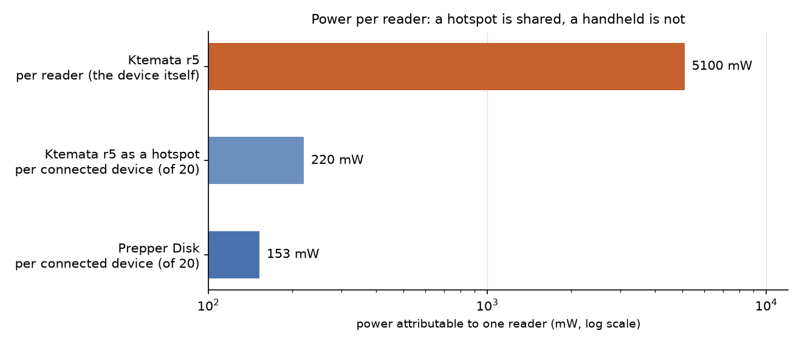
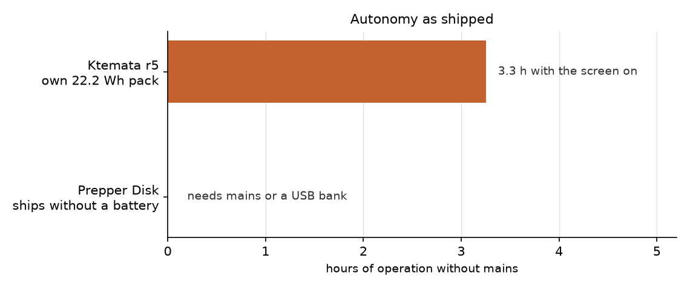

# Ktemata vs Prepper Disk — pros and cons

Two offline libraries on Raspberry Pi hardware. They overlap in content and diverge in almost
everything else:

| | Ktemata r5 | Prepper Disk Premium |
|---|---|---|
| What it is | a **handheld computer**: screen, keyboard, battery, all in one rugged case | a **headless hotspot**: plug it in, join its Wi-Fi, browse from your own phone |
| Board | Pi 5, 4 GB, NVMe | Pi 4B, 2 GB, 512 GB microSD |
| Case | printed cassette inside a bought Peli 1200 | machined aluminium, 89 × 70 × 25 mm |
| Price | ≈ €635 built (`BOM.md`) | €270.95 (or €150.95 software-only) |
| Where the work goes | designing, printing, wiring, software | none — it arrives configured |
| Source | this repository, MIT-style DIY | closed product, proprietary UI on Internet-in-a-Box |

The honest summary: **the Prepper Disk is the better product; Ktemata is the better device for one
specific job.** The Prepper Disk wins on price, size, weight, power, polish and support — on
serving a room *by default*, though Ktemata now has the same function behind one install flag — and
on EMP, where it sells a working bag for €22 while Ktemata's shielding is still a plan. Ktemata wins on independence from other devices, on storage and upgradeability,
on being field-repairable, and on being a computer you can use *with no phone in the room*. Which of
those matters depends entirely on whether you expect to have a working phone and a charged laptop
with you.

## Where the Prepper Disk wins

**Price.** €271 against ≈ €635. Half the cost, and a quarter if you already own a Pi (€151 for the
card). The Ktemata BOM buys a Pi 5, a 143 mm display, a UPS HAT, 18650 cells, a mechanical keyboard,
an NVMe drive, a Peli case and a solar path; the Prepper Disk buys a Pi 4B, a card, and a milled
enclosure.

**Size and weight.** 89 × 70 × 25 mm, about 158 cm³ and ~200 g. Ktemata r5 in its Peli 1200 is
roughly 8.3 litres and ~1.6 kg — **53× the volume, 8× the mass**. If the criterion is "fits in a
glovebox, a jacket pocket, a go-bag lid", there is no contest. This is the single biggest practical
difference.

**Power and autonomy per reader.** Measured Pi 4B idle is 2.7 W (540 mA at 5 V, nothing on USB) plus
~0.35 W for its access point: **3.05 W, 73 Wh/day**. Ktemata r5 draws 4.0 W screen-off and 5.1 W with
the display lit — 96–139 Wh/day. On identical 24/7 duty the Prepper Disk uses about **a quarter
less energy** (73 against 96 Wh/day), and it needs no display.

**It serves a room by default.** Up to 20 phones, tablets and laptops at once, over its own
Wi-Fi. At 3.05 W that is ~152 mW of server power per connected device, against 5.1 W for the person
holding the Ktemata.

Ktemata now does this too, so this is **no longer a difference in capability**. The Pi 5 has the
same dual-band radio as the Prepper Disk's Pi 4B, and `post-install.sh --hotspot` builds the access
point (NetworkManager profile, else `hostapd` + `dnsmasq`) serving the same ZIM files to the same
browsers. The cost is about 0.4 W, which moves r5 to 4.4 W and **220 mW per connected device** —
the same league, with the machine keeping its own screen and battery while it serves.

What the Prepper Disk still has over it is simplicity: the hotspot *is* the product, it is already
configured, and there is no install flag to pass.

**No assembly, no printing, no wiring.** It arrives configured, tested, with a one-year warranty,
60-day returns, 7,000+ units shipped and a 4.8-star review base. Ktemata r5 requires a 3D printer,
a soldering iron for the pack leads, firmware flashing, an OpenSCAD toolchain, and the willingness to
debug a buck converter. That is the whole point of this repository, but it is not a product.

**Content is licensed and curated, and it updates.** Includes material you cannot assemble yourself:
Ky Furneaux field guides, original Prepper Disk books, MDWiki, RepeaterBook, a Morse decoder, an
emergency phrase translator, plus National Park trail maps for all 63 US parks. Ongoing content
updates are part of the offering. Ktemata's page deliberately stops at "download ZIMs yourself".

**It sells you the shielding as an accessory.** €21.95 for a Faraday Defense NX3 bag (127 × 178 mm,
85–90 dB claimed), which the Prepper Disk fits into with room to spare — 89 × 70 × 25 mm. That is
an honest, working answer to EMP for €22, and it exists today. Ktemata's version of this is a
proposal for a future revision, not a product you can buy.

**Polish and support.** Custom UI over Internet-in-a-Box, 10.10.10.10 landing page, one-year hardware
warranty, US-based support from the founders. When it breaks, someone answers.

## Where Ktemata wins

**It works alone.** The Prepper Disk is useless without a charged client device. In a real grid-down
scenario — or just on a hike, in a tent, or three days into a power cut — the phone you were going to
browse from may be the first thing to die. Ktemata has a 720 × 1280 touchscreen, a keyboard with a
trackpad, and its own battery: open the lid and read, no second device, no Wi-Fi, no DHCP, no
browser tab. That is not a feature you can add to a headless hotspot.

**It carries its power.** The HAT (B) with 2× 18650 gives **3.3 h with the screen on, up to 4.2 h
screen-off**, and it charges from 8.4 V — so solar and the hand-crank generator (a separate,
published design) can top it up. The Prepper Disk **ships without a battery**: it expects mains or a
USB bank.

On a 20 Ah USB bank the Prepper Disk runs ~18 h, which is excellent — but that bank is another
€40–70, another 350 g, and a 5 V path that cannot feed Ktemata's HAT (the two power architectures are
not interchangeable).

**Storage is bigger and replaceable.** 512 GB NVMe in a standard M.2 socket, Gen2 link, 300 TBW, and
a 1 TB 2242 or SATA upgrade is a drive swap. The Prepper Disk's 512 GB is a **microSD card** — slower,
wear-limited, and the single most common failure point in Pi deployments. Its own FAQ lists a
"reliable 512 GB microSD" at $95–125 as the dominant cost of a DIY build. Note that *neither* holds
the full 833 GiB Ktemata library: 512 GB formats to ~477 GiB, so both are at roughly half.

**It is a general computer.** Pi 5 with 4 GB and a real SSD runs a desktop, a browser, Kiwix, a
terminal, `ssh`, Python, an editor. The Prepper Disk is an appliance: browse what it serves, and
that is the contract. If the library is one tool among many, a computer is the better shape.

**A future r6 could shield the case itself.** The Peli 1200 is a large, flat-walled, moulded ABS
enclosure with a single continuous lid seam — nothing like an ideal Faraday box, but far easier to
convert than a milled aluminium brick with a USB-C port. The proposal for a later version is a
conductive lining plus a conductive seam gasket, so the machine is protected *while sitting in its
own case* rather than only while sealed in a bag. The physics of what that takes is below; the
short version is that it is feasible at the CISA Level 1–3 end (30 dB) and not at the military end.

**You can fix it.** Every part is off-the-shelf and documented: a standard Pi 5, a standard display,
a standard UPS HAT, a Peli case, printed parts with published STLs. A failed Pi is a €85 swap; a
failed screen is €60; a cracked shell is a reprint. The Prepper Disk's aluminium enclosure and
custom integration are not field-serviceable, and its warranty is one year against a lifetime of
expected use.

**No vendor, no licence, no dependency.** MIT firmware and tooling, CC BY-SA CAD and prose in this
repo, ZIM files from the Kiwix catalogue, no account, no content licence that can be withdrawn, no
company that can stop shipping. The Prepper Disk's exclusive content and curated UI are genuine value
— and also a dependency.

**It is repairable and inspectable at the source level.** The firmware in `firmware/` is 1,000 lines
you can read, with the I²C addresses, the UPS gauge protocol and the OLED screens all documented. A
battery-percentage bug is a pull request, not a support ticket.

## EMP: a case lining versus a bag

This is a **planned r6 direction, not a shipped feature**, so treat it as an assessment of what is
achievable rather than a claim about the current build.

A Peli 1200's interior is 1730 cm² of moulded ABS with one continuous lid/base joint. Coating that
surface and gasketing that joint is the whole job; there is no welding, no casting, no seams to
machine. What it is *not* is a shortcut to real EMP hardness, because shielding effectiveness is set
almost entirely by the **largest aperture**, and a moulded case arrives with an 835 mm one.

Worst-case estimate from the slot-antenna model, `SE ≈ 20·log10(λ / 2L)`, at 1 GHz (λ = 300 mm):

| Longest un-gasketed aperture | Worst-case SE | Verdict |
|---|---|---|
| 835 mm — the lid/base seam as shipped | **−14.9 dB** | amplifies, worse than no case |
| 100 mm — one 10 cm hole | +3.5 dB | below CISA Level 3 |
| 20 mm — one 2 cm hole | +17.5 dB | below CISA Level 3 |
| 5 mm — one 5 mm hole | +29.5 dB | just below Level 3 |
| 2 mm — one 2 mm hole | +37.5 dB | meets Level 3 |

So a painted interior with the stock O-ring seal achieves nothing at all: the seam radiates. The
lining only starts working once the seam carries a **conductive gasket**, and then the gasket's
contact spacing — not its material — sets the result:

| Target | Largest allowed aperture at 1 GHz | What it takes |
|---|---|---|
| 30 dB (CISA Level 3) | 4.74 mm | conductive gasket with contacts under ~5 mm, in the existing O-ring groove |
| 40 dB (typical MIL-STD-461) | 1.50 mm | finger-stock or a machined gasket channel |
| 80 dB (CISA Level 4) | 0.01 mm | a welded, seamless metal box — not a moulded case |

The practical build for r6:

- **Coating:** copper-loaded conductive paint over the whole interior, two coats, ≈ 69 mL at 5 m²/L.
  Vendor data puts such coatings at 75 dB+ from 1 MHz to 1 GHz on plastic; on its own that is not the
  limit.
- **Seam:** one continuous conductive gasket, 835 mm, compressed by the existing latches. Knitted
  wire over silicone gives the ~5 mm contact spacing that Level 3 needs and keeps the case's own
  water resistance; a solid extruded profile can do both jobs in one part. The stock O-ring must be
  kept or replaced by a dual-purpose gasket, or the case loses IP67 in exchange for EMP.
- **Penetrations:** the charge socket, the status button and the vent are holes in the shield. Each
  needs either a filtered/feed-through connector or a waveguide-below-cutoff treatment; the vent
  membrane is transparent to RF and must be replaced by a shielded vent or closed in the shielded
  build.
- **The display is a window.** 143 × 91 mm of glass is an aperture larger than any realistic gasket
  can seal. A conductive mesh or transparent conductive coating over it is the only answer, and it
  costs optical quality. This is the point where "shield the case" stops being a weekend job.
- **The keyboard is a hole too.** Its 151 × 59 mm opening in the deck is another aperture; a
  shielded case with an open key window is only shielded when the lid is shut over a sealed face.

Cost estimate: conductive paint €25–40, 1 m of gasketed profile €20–50, shielded vent and feed-through
parts €30–60, plus a mesh or ITO film for the display €30–100. Call it **€100–250 on top of the
€635 build**, and it needs a shield-effectiveness test to be worth anything.

**The honest comparison.** The NX3 bag is €22 and claims 85–90 dB, because a bag has no seam, no
port, no display and no button — it is a sealed pouch you put the device into. That is why the
accessory route wins on effort, cost and measured performance. What a case lining buys is
**availability**: the machine stays protected while it is being carried, not while it is packed away,
and there is no bag to open (and no reason to open it) at the moment you need the library. For a
handheld that you expect to grab and use, that is a real difference; for a device that lives in a bag
until needed, it is not worth the engineering.

Two things worth keeping in proportion. First, E1 couples mainly into **cables and antennas**, so
for a powered, mains-connected device the lead is a bigger risk than the plastic wall — switching off
and unplugging removes most of the exposure. Second, **a shut Peli is not a shield**: by the table
above its un-gasketed seam is −14.9 dB at 1 GHz, i.e. worse than nothing, and CISA's own Level 1
advice for stored spares is "wrap in aluminium foil or put in Faraday containers", not "put it in a
plastic case". So the cheap version of this section is a bag or a foil wrap for both machines; the
expensive version is the gasketed lining, and only one of the two vendors sells you anything in
between.

## Head to head

| Criterion | Ktemata r5 | Prepper Disk | Edge |
|---|---|---|---|
| Price | ≈ €635 | €271 | **Prepper Disk** 2.3× cheaper |
| Volume / mass | ~8.3 L, ~1.6 kg | ~0.16 L, ~0.2 kg | **Prepper Disk** 53× smaller |
| Draw, 24/7 | 4.0–5.1 W | 3.05 W | **Prepper Disk** ~¼ less energy/day |
| Energy/day | 96–139 Wh | 73 Wh | **Prepper Disk** 1.3–1.9× |
| Autonomy as shipped | 3.3–4.2 h | none (mains/USB bank) | **Ktemata** |
| Readers served | up to 20 with `--hotspot` (one flag) | up to 20 | tie, Prepper Disk by default |
| Needs another device | no | yes | **Ktemata** |
| Storage | 512 GB NVMe, upgradeable | 512 GB microSD, replaceable | **Ktemata** (durability) |
| Setup effort | print, wire, flash, debug | plug in | **Prepper Disk** |
| Repairability | any part, documented | warranty only | **Ktemata** |
| Content | whatever you download | curated, licensed, updated | **Prepper Disk** |
| Independence from a vendor | none | content and UI are proprietary | **Ktemata** |
| Ruggedness | IP67 Peli + printed cassette | milled aluminium, not IP-rated | tie (different threats) |
| EMP protection | planned lining for a future revision (30 dB feasible, needs work) | €21.95 Faraday bag, 85–90 dB claimed, available now | **Prepper Disk**, today |
| EMP while carrying | the machine itself, if the lining is built | only inside the bag | **Ktemata**, once built |

## Which to build or buy

- **Buy the Prepper Disk** if you want an offline library in a bag, will have phones or laptops with
  you, want it working in ten minutes, and would rather spend €271 than a weekend. It is the right
  answer for most people.
- **Build Ktemata** if the point is a self-contained reading and computing device that works with
  nothing else in the room, if you want to own and repair the hardware, if 512 GB of NVMe and the
  option to swap in a terabyte matters, or if the building is the point. If you also want the
  hotspot, enable the radio — it is already there.
- **Both** is not silly: €271 for the family hotspot plus a handheld for the person who walks out
  with the bag. They share the same ZIM files and the same Kiwix software, so the second copy costs
  only storage. Equally, one Ktemata can do both — enable the radio when a group needs it, leave it
  off when the point is to be unfindable.

## Sources and caveats

- Prepper Disk: [prepperdisk.com](https://www.prepperdisk.com/) product page (Pi 4B 2 GB, 512 GB,
  89 × 70 × 25 mm, 20 devices, €270.95, one-year warranty), its
  [DIY page](https://www.prepperdisk.com/pages/diy-prepper-disk-adv) for the parts-and-cost breakdown,
  and its product copy for the content list.
- Pi 4B idle draw: [Dramble power benchmarks](https://www.pidramble.com/wiki/benchmarks/power-consumption.html),
  540 mA at 5 V with nothing on USB. The 0.35 W (Prepper Disk) and 0.4 W (Ktemata) access-point
  figures are **estimates**, unmeasured; the Pi 5's radio draws at the same order as the Pi 4B's.
- Ktemata figures: `docs/POWER.md`, same 24/7 basis, same η = 0.88 / 0.85 DoD / 3.5 PSH / 0.65 derate
  assumptions. Prices from `BOM.md` (reconciled orders; r5's Peli 1200 is not yet in that total, so
  treat ≈ €635 as indicative).
- Volume and mass for Ktemata are computed from the Peli 1200's external dimensions plus the
  cassette; the Prepper Disk's from its published 3.5 × 2.75 × 1 in.
- The Prepper Disk's content list, review scores and shipping claims are the vendor's own; this page
  does not independently verify them. The same applies to the NX3 bag's 85–90 dB attenuation figure.
- EMP: the 30 dB / 80 dB levels are from
  [CISA's EMP Protection and Resilience Guidelines](https://www.cisa.gov/sites/default/files/publications/19_0307_CISA_EMP-Protection-Resilience-Guidelines.pdf)
  (Level 3 and Level 4 respectively, "through 10 GHz"). The aperture figures are worst-case
  slot-antenna estimates, not measurements — real shielding depends on gasket contact quality,
  fastener spacing, coating resistance and how each penetration is treated. Conductive-coating
  performance on plastic from [MAJR](https://www.majr.com/conductive-coatings-for-plastic-hardened-enclosures/).
  **No shielding-effectiveness measurement has been made on a Ktemata case, and none is planned
  until a prototype exists.**
- Reproduce every number here with `python3 work/scripts/power_chart.py --compare` (power, cost,
  per-reader) and `python3 work/scripts/power_chart.py --emp` (shielding geometry).
