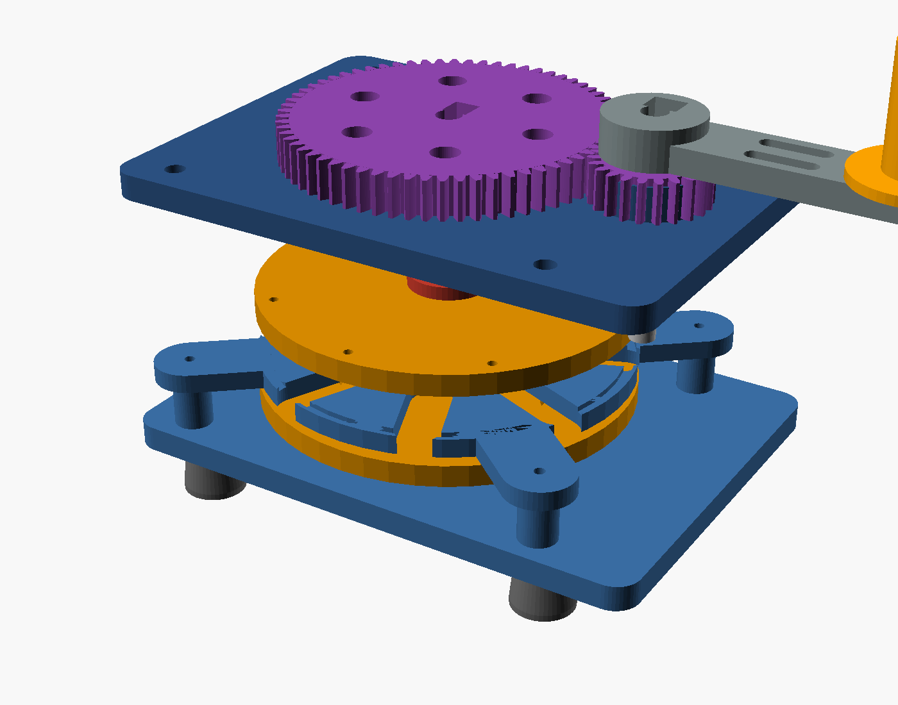
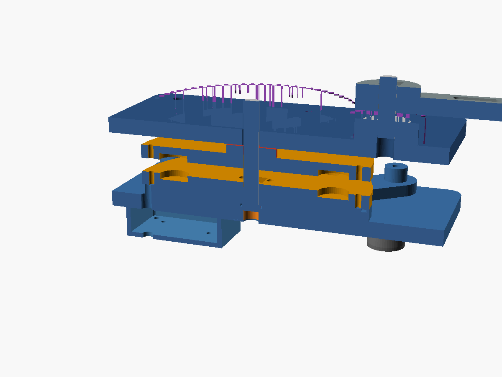

# Pi Fluks r3 — hand crank generator

The backup charger, modelled in `cad/crank_*.scad` and exported to `stl/crank/`. It is a **separate
unit**: it does not fit in the case, a shaft through the wall would break the seal, and the reaction
torque of cranking would need a second hand on the case. Its output feeds the same sealed USB-C charge
port as the solar panel (see `WIRING.md`).

*Exploded view: base plate and posts, stator with its 8 coil windows, the two rotor discs, top plate,
66T/22T gear pair, crank arm and knob.*

*Half-section through both axes: the two magnet rotors either side of the stator, the 608 bearings and
the clamp hubs, and the electronics tray under the base plate.*

## How it works

An **axial-flux alternator** with a 3:1 spur-gear step-up:

- two **rotors** (the same printed disc, one flipped) each carry 8 N52 disc magnets on a 42 mm pitch
  radius, with alternating polarity around the circle;
- a **stator** between them has 8 coil windows; the magnets sweep past, so each coil sees a reversing
  field;
- the coils are wired **2 in series / 4 in parallel**, rectified by a bridge, buffered by capacitors and
  fed to a 5 V USB module in the tray;
- the crank drives the rotor through a 66T : 22T pair, so a comfortable 60 rpm at the handle gives
  180 rpm at the rotor.

Everything is printed in PLA/PETG except the shafting, bearings and fasteners. All parts print flat with
no supports.

## Printed parts

| Part | Qty | Notes |
|---|---|---|
| `crank_base` | 1 | Base plate, four M3 insert posts, 608 pocket for the rotor shaft |
| `crank_stator` | 1 | 8 coil windows, 4 mounting lugs (M3 through), wire channel on top |
| `crank_top` | 1 | Top plate, 608 pocket in the crank boss, rotor guide bore |
| `crank_rotor` | 2 | 8 magnet pockets, 4 screws to the hub; use one as printed and one flipped |
| `crank_hub` | 2 | Clamp hub with a pinch slit: one under the bottom rotor, one above the top rotor |
| `crank_gear_big` | 1 | 66T, 1.5 mm module, clamp hub on the rotor shaft |
| `crank_gear_small` | 1 | 22T, clamp hub on the crank shaft |
| `crank_arm` | 1 | Arm plus M6 knob bolt and nut trap |
| `crank_knob` | 1 | Printable knob (an M6 star knob also works) |
| `crank_tray` | 1 | Electronics tray under the plate, gland for the output cable |
| `crank_lid` | 1 | Screw-on lid with a vent slot |
| `crank_foot` | 4 | Screw-on feet with M3 nut traps; set the 20 mm bench clearance |

## Bought parts

| Item | Qty | Size / spec |
|---|---|---|
| N52 disc magnets | 16 | Ø15 × 3 mm |
| 608-2RS bearings | 2 | 8 × 22 × 7 mm |
| Silver-steel shaft | 2 | Ø8 mm, one ground flat; rotor 55 mm, crank 32 mm |
| M3 socket screws | 4 × 30 | Stack screws: top plate → spacer tube → stator lug → base post insert |
| M3 × 12 | 8 | Rotor discs to clamp hubs |
| M3 × 8 + nuts | 8 | Tray lid and feet |
| M6 × 40 bolt + nut | 1 | Knob through the crank arm |
| M3 heat-set inserts | 8 | 4 in the base posts, 4 in the plate underside for the tray |
| Enamelled copper wire | ≈ 40 m | 0.3–0.4 mm, 300–350 turns per coil |
| Bridge rectifier | 1 | e.g. KBPC2504 or a 4× 1N5408 bridge |
| Capacitors | 2–3 | 1000 µF 25 V (buffer) |
| 5 V USB buck module | 1 | MP1584 / LM2596 set to 5.1 V, 1 A |
| USB-A pigtail | 1 | To the case charge port or a USB-C adapter |
| Spacer tubes | 4 | Ø14 × 11.9 mm (printed or aluminium, cut to `CR_TPOST_H`) |

## Assembly

1. **Rotor discs.** Press the 16 magnets in with alternating polarity (mark the north faces first; a
   stack test with two magnets tells you the poles). Glue them flush.
2. **Bottom bearing.** Press a 608 into the base plate pocket until it is flush with the plate top.
3. **Bottom rotor.** Slide the hub onto the shaft (flat to flat), sit it on the bearing inner race,
   drop the first disc over the hub (magnets facing **up**, away from the plate) and screw it to the hub.
4. **Stator.** Heat-set the four M3 inserts into the base-plate posts, then lower the stator onto them,
   coil windows up. The wire exit notch sits at −x.
5. **Coils.** Wind 8 coils of ≈300–350 turns each, tape them, and lay them into the windows. Join them
   2-in-series/4-in-parallel, run the ends through the channel and out the −x hole.
6. **Top rotor.** Fit the second hub above the second disc (magnets facing **down**, toward the stator),
   then lower it onto the shaft. Keep the two magnet rings aligned: the top rotor's magnets must sit
   opposite the bottom rotor's poles.
7. **Top plate.** Add the four spacer tubes and the top plate; the four M3×30 screws clamp the stack.
   Press the second 608 into the crank boss and fit the crank shaft.
8. **Gears.** Clamp the 66T gear to the rotor shaft above the top plate, and the 22T gear to the crank
   shaft. They mesh with ≈0.4 mm backlash at the modelled 66.4 mm centre distance. Check for free
   rotation before fitting the arm.
9. **Crank.** Bolt the arm to the crank shaft and the knob through the arm end.
10. **Electronics.** Fix the rectifier, capacitors and 5 V module in the tray, wire them, run the output
    through the gland, and screw the tray and lid under the plate. Fit the four feet.
11. **Test.** With a multimeter on the output: slow turning should give ≥5 V open circuit at the module
    input; the module output must hold 5 V under a phone load. Check that nothing rubs: the rotor should
    spin freely with the magnets cogging slightly.

## Electrical notes

- **Wiring:** 8 coils at ≈0.35 mm wire, 300–350 turns each. Two in series per branch, four branches in
  parallel: about 10–15 V AC at 150–200 rpm, which the rectifier and capacitor bank turn into a stiff
  DC rail for the 5 V module.
- **Output:** the 5 V module feeds a USB-A pigtail; use a USB-A→USB-C cable into the case's sealed charge
  port. Do **not** connect the raw alternator to the case: the UPS needs a regulated 5 V input.
- **Power:** expect 5–10 W at the battery after losses for 10–20 W of arm effort, i.e. about 1 minute of
  cranking per minute of Pi runtime, and 7–14 h to refill the 4S pack. Cranking a phone charge is the
  realistic use.
- **Direction and polarity:** the bridge rectifier makes the output polarity independent of crank
  direction, so the handle can be turned either way.
- **Safety:** the alternator can produce well over 20 V open circuit if spun fast; the 5 V module's input
  rating is the limit. Fit the capacitor bank before the module and never short the output.

## Printing notes

- No supports anywhere: every part prints flat or standing on a flat face.
- The rotor discs are identical; print two and flip one.
- The gears print flat. Use 4 walls and 40 % infill for the 66T gear; the teeth are 1.5 mm module.
- PETG for the gears and arm is worth it; PLA is fine for the frame.
- The stator needs the coil windows clean: print at 0.2 mm layers and check the windows before winding.
