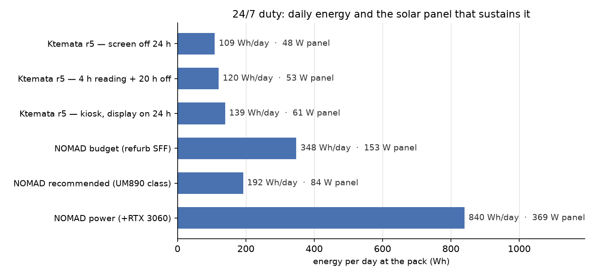
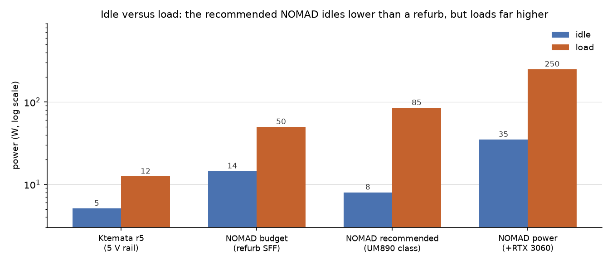

# Power budget — Ktemata r5 vs Project NOMAD, all running 24/7, no AI

Ktemata r5 is the internal-cassette build: r4's electronics (Pi 5, Touch Display 2, UPS HAT (B)
with 2× 18650, Rii K06) in a bought hard case, and **no air-quality sensor**. This page prices
its energy against Project NOMAD's three hardware tiers with the AI left off, which NOMAD's own
FAQ supports ("the AI is 100% optional").

**Both are scored over the same 24 hours.** That is the point of the comparison: Ktemata is a
handheld, but a machine that is on all day can still be compared with a station that is on all
day, and the r5 pack is what it has to carry itself. Two of the three Ktemata rows below are
therefore deliberately unflattering duty profiles, not the handheld best case:

- **screen off 24 h** — a pure server role, nobody reading (its best case)
- **4 h reading + 20 h off** — normal handheld use spread over a day
- **kiosk, display on 24 h** — a wall display nobody switches off (its worst case)

NOMAD is headless and serves browsers over the LAN, so 100 % of its 24 h is idle or loaded with no
display of its own attached. Its AI is off in every row.



| Platform (24/7, AI off) | Draw | Wh/day | Solar panel | Battery, 1 day | €/yr at €0.30/kWh |
|---|---|---|---|---|---|
| Ktemata r5 — screen off 24 h | 4.0 W (5 V) | 109 | 48 W | 128 Wh | €12 |
| Ktemata r5 — 4 h reading + 20 h off | 4.4 W (5 V) | 120 | 53 W | 142 Wh | €13 |
| Ktemata r5 — kiosk, display on 24 h | 5.1 W (5 V) | 139 | 61 W | 164 Wh | €15 |
| NOMAD budget (refurb SFF) | 14.5 W (wall) | 348 | 153 W | 409 Wh | €38 |
| NOMAD recommended (UM890 class) | 8.0 W (wall) | 192 | 84 W | 226 Wh | €21 |
| NOMAD power (+RTX 3060) | 35 W (wall) | 840 | 369 W | 988 Wh | €92 |

Panel and battery columns use 3.5 peak-sun-hours at 0.65 derate and 0.85 depth of discharge — both
assumptions, see [Caveats](#caveats). Costs are the grid-price equivalent of the energy, not a
purchase.

Read against the handheld's own pack, the last two columns are the interesting ones: **Ktemata's
22.2 Wh pack is a 3–4 hour buffer**, while a 24/7 NOMAD station needs **226–988 Wh** to ride out a
single day without sun. The pack does not scale into that role; it was never meant to.

## Ktemata r5

Component draws, from measurements where measurements exist:

| Component | Idle | Load | Source |
|---|---|---|---|
| Pi 5 (4 GB) | 3.0 W headless; 3.6 W with Ethernet + USB + HDMI | 8.8 W all-core; up to 16 W with USB-SSD + 4K | [raspberry.tips Pi 5 measurements, Oct 2026](https://raspberry.tips/en/raspberrypi-tutorials/raspberry-pi-power-consumption-update-2026-all-models-compared) |
| Pi 5, soft-off | **1.7 W** — the PMIC stays alive | — | same |
| Touch Display 2, 5" | 1.4 W (backlight) | 1.4 W | Pi product brief / `BOM.md` |
| NVMe, WD SN740 | ~0.5 W | 4.7 W max | drive datasheet; Pi 5 NVMe figures |
| FireBeetle 2 + 1.3" OLED, radios off | ~0.2 W | ~0.2 W | ESP32 ~40–50 mA at 3.3 V + OLED, estimate |
| UPS HAT (B) 2S → 5 V buck | — | η ≈ 0.88 **assumed** | not measured |
| ~~BME688~~ | — | — | **removed in r5**; it was milliwatts in forced mode, so its absence does not move these numbers |

States and runtime. The pack column applies η = 0.88 and 0.85 usable depth of discharge, so 22.2 Wh
gives ≈ 16.6 Wh at the 5 V rail:

| State (r5) | 5 V rail | at the pack | runtime, 22.2 Wh (3.0 Ah) | runtime, 25.9 Wh (3.5 Ah) |
|---|---|---|---|---|
| Screen off, Pi up | 4.0 W | 4.5 W | 4.2 h | 4.8 h |
| Idle, screen on | 5.1 W | 5.8 W | 3.3 h | 3.8 h |
| Reading / Kiwix, light touch | 6.5 W | 7.4 W | 2.6 h | 3.0 h |
| Browsing Wikipedia + maps | 8.7 W | 9.9 W | 1.9 h | 2.2 h |
| Heavy (video, CPU stress) | 12.5 W | 14.2 W | 1.3 h | 1.5 h |

`README.md` and `BOM.md` claim **2–2.5 h** of Pi 5 runtime. That holds and is the right conservative
number: 22.2 Wh over 2–2.5 h is 8.9–11.1 W at the pack, i.e. the browsing and heavy rows. It
understates screen-off use (4.2 h) and reading (2.6 h).

**r5 specifically** (against r4, same electronics): the sealed host has no through-wall vent, so the
Pi 5 reaches its 80 °C throttle point under sustained load instead of holding boost. That does not
change idle or reading draw — it caps the *heavy* row in time rather than in watts. The removed
air-quality sensor saves nothing measurable. The 12.5 W heavy figure is therefore an upper bound
that the thermal limit enforces.

## Project NOMAD, AI off

AI-off is a supported configuration, and it does not change idle: the same box, OS and service
stack still run. What it removes is the inference bursts, which only matter if the machine is
loaded for long stretches.

| Tier | Price | Hardware | Idle (measured) | Load |
|---|---|---|---|---|
| Budget | $150–300 | used OptiPlex Micro / ThinkCentre Tiny / EliteDesk Mini, i5/i7 8th gen+, 16–32 GB DDR4, 500 GB SSD | **11–18 W** | 35–65 W (NOMAD's own "15–65 W" range) |
| **Recommended** | $500–800 | Minisforum/Beelink, Ryzen 7/9 (8845HS, Radeon 780M), 32 GB DDR5, 1 TB NVMe | **7–9 W** | **80–90 W** |
| Power | $1,000+ | as above + RTX 3060 12 GB or better | ~30–40 W (**inferred**: a 3060 Ti alone idles at 11 W with screens off) | 200–300 W (inferred from GPU TBP + host) |

Idle figures are independent measurements rather than vendor claims: OptiPlex 7060 Micro just over
18 W and 7070 Micro just over 13 W for six-core units
([ServeTheHome](https://www.servethehome.com/dell-optiplex-7070-micro-project-tinyminimicro-guide-and-review/3/));
ThinkCentre M710q 11–13 W, M920q 12–15 W, M75q Gen 2 ≈ 12 W (same series); Minisforum UM890 Pro
**7–9 W idle, 80–90 W load**
([ServeTheHome](https://www.servethehome.com/minisforum-um890-pro-review-re-architected-amd-ryzen-8945hs-mini-pc/4/)).



The shape matters more than any single number. The recommended build **idles lower than a
refurbished SFF PC** (8 W against 14.5 W) yet **loads 10.6× above its own idle** (85 W) where the
refurb manages 3.4× (50 W). For a 24/7 library that is the better profile — most hours are idle —
and it is why its daily energy is lower than the budget tier's despite costing about three times as
much ($500–800 against $150–300).

## The comparison

| | Ktemata r5 | NOMAD budget | NOMAD recommended | NOMAD power |
|---|---|---|---|---|
| Energy per day (24/7) | **109–139 Wh** | 348 Wh | 192 Wh | 840 Wh |
| Solar panel to sustain it | **48–61 W** | 153 W | 84 W | 369 W |
| Battery for 1 day without sun | **128–164 Wh** | 409 Wh | 226 Wh | 988 Wh |
| Typical continuous draw | 4.0–5.1 W | 14.5 W | 8.0 W | 35 W |
| Ratio to Ktemata (4 h reading) | 1.0× | 2.9× | 1.6× | 7.0× |
| Grid cost per year | €12–15 | €38 | €21 | €92 |

- **On identical 24/7 duty, Ktemata uses 1.6–7× less energy than any NOMAD tier**, and it is the
  only one of the four whose shipped battery can run it at all — the others need a separate 226 Wh+
  bank. That same 22.2 Wh pack gives a NOMAD recommended box 2.1 h idle and 0.2 h loaded.
- **NOMAD does more per watt only if you count served users.** A Ryzen 8845HS answers several
  browser clients at once and hosts the whole stack (dashboard, Kiwix, maps, courses); the Pi 5
  drives one handheld screen. Watts per hour flatter the handheld; watts per concurrent reader
  flatter the mini PC. Neither is a fair single number, so this page does not claim one.
- **The power tier is in a different class.** A 24/7 RTX build (840 Wh/day, 369 W of panel) is a
  fixed installation with a battery bank, not something you carry. Its idle draw alone (35 W) is
  5.4× Ktemata's *reading* draw (6.5 W).
- **The 20–30 W panel in this repository cannot run any NOMAD tier 24/7.** At 3.5 peak-sun-hours
  and 0.65 derate it delivers ≈ 46–68 Wh/day, i.e. 33–63 % of even Ktemata's daily need — so a
  24/7 role needs the 48–61 W the table asks for, not the 20–30 W the BOM lists. For a NOMAD
  station it is a quarter of the recommended tier's panel and a twentieth of the power tier's
  (84 W and 369 W respectively), with 226–988 Wh of battery behind them.
- **Ktemata's own pack does not cover a 24/7 day.** 128–164 Wh is what the 24/7 profiles above
  need; the shipped 22.2 Wh is a session buffer of 2.6–4.2 h. That is a design statement, not a
  shortfall: the device is carried and recharged, and a pack large enough for 24/7 (≈ 130 Wh, a
  6× increase) would not fit the case at all — the 2× 18650 holders are the case's floor.

## Reproducing these numbers

Every figure on this page comes from one script, which also writes the two charts:

```bash
python3 work/scripts/power_chart.py            # tables to stdout + charts into docs/
python3 work/scripts/power_chart.py --tables   # tables only, no images
```

Edit the measured constants at the top of that file (`K`, `PROFILES`, `NOMAD`) and both the tables
and the images follow, so the prose and the data cannot drift apart — except the prose, which quotes
the numbers above and has to be re-read when they change.

## Caveats

- **Assumptions, not measurements**: η = 0.88 for the HAT (B) buck, 0.85 usable depth of discharge,
  3.5 peak-sun-hours, 0.65 panel derate, €0.30/kWh. The HAT (B)'s INA219 at I²C 0x42 reports the
  pack side directly once the firmware reads it — that is the measurement to make first.
- **Cell capacity drives the runtime.** 3.0 Ah cells give 22.2 Wh, 3.5 Ah cells 25.9 Wh (+17 %);
  both columns are in the table because the BOM does not fix a capacity.
- **Pi 5 soft-off is not off**: ~1.7 W until the supply is cut. On r5 the UPS keeps the 5 V rail
  alive, so "screen off, Pi up" is a real state, not a figure of speech. Only the HAT's output
  switch (or pulling the pack) reaches zero.
- **The Ktemata figures are at the 5 V rail**, the NOMAD figures at the wall including the PSU.
  The "at the pack" column exists so the two can be compared without pretending the conversion is
  free.
- **The NOMAD power build's idle is inferred**, not measured — no review publishes a 24/7 idle for
  that exact combination. It is marked as such wherever it appears.
- **AI-off NOMAD still loads hard when busy**: installing content, transcoding or compiling reaches
  65–90 W. The daily figures assume idle-dominated use, which is what a library server is.
- **r5's thermal limit is a time limit.** In the sealed host the Pi 5 throttles under sustained
  load, so a NOMAD-style always-busy workload is not something r5 could do even at its wattage.
