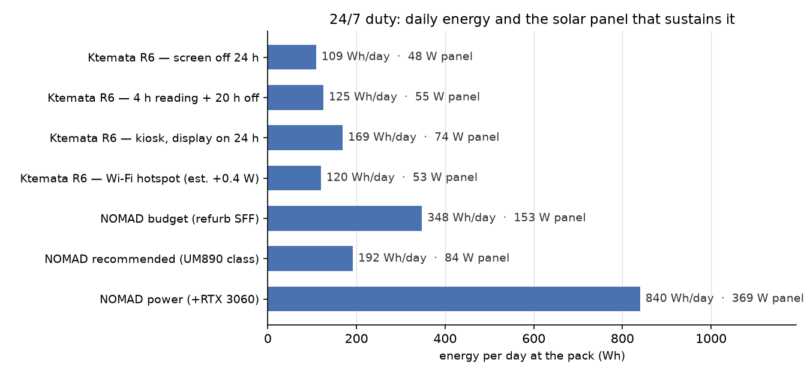
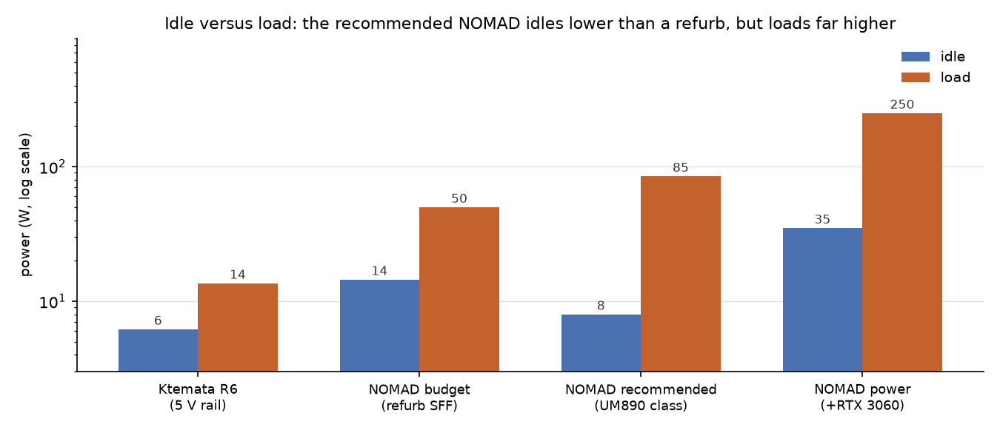

# Power budget — Ktemata R6 vs Project NOMAD, all running 24/7, no AI

R6 is the current build: Raspberry Pi 5 (4 GB), Waveshare **7inch DSI LCD (C)**, NVMe Base Duo,
Rii K06, and a **Waveshare UPS Module 3S with three 18650 cells in
3S**. R5 (Pi 5, 5-inch Touch Display 2, UPS HAT (B) with 2×18650) is historical; this page is
recalculated for the 3S pack and larger display.

Both machines are scored over the same 24 hours. NOMAD is headless and serves browsers over the
LAN, so its whole day is idle or loaded with no display. Ktemata's display is bolted to the
device, so its profiles include screen-off and screen-on duty:

- **screen off 24 h** — a pure server role, nobody reading (its best case)
- **4 h reading + 20 h off** — normal handheld use; the 20 h are still Pi-up, display-off
- **kiosk, display on 24 h** — a wall display nobody switches off (its worst case)



| Platform (24/7, AI off) | Draw | Wh/day | Solar panel | Battery, 1 day | €/yr at €0.30/kWh |
|---|---|---|---|---|---|
| Ktemata R6 — screen off 24 h | 4.0 W (5 V) | 109 | 48 W | 128 Wh | €12 |
| Ktemata R6 — 4 h reading + 20 h off | 4.6 W (5 V) | 125 | 55 W | 148 Wh | €14 |
| Ktemata R6 — kiosk, display on 24 h | 6.2 W (5 V) | 169 | 74 W | 199 Wh | €19 |
| Ktemata R6 — Wi-Fi hotspot (est. +0.4 W) | 4.4 W (5 V) | 120 | 53 W | 141 Wh | €13 |
| NOMAD budget (refurb SFF) | 14.5 W (wall) | 348 | 153 W | 409 Wh | €38 |
| NOMAD recommended (UM890 class) | 8.0 W (wall) | 192 | 84 W | 226 Wh | €21 |
| NOMAD power (+RTX 3060) | 35.0 W (wall) | 840 | 369 W | 988 Wh | €92 |

Daily energy is shown at the pack for Ktemata and at the wall for NOMAD, i.e. what the source
actually has to supply. Panel and daily-battery columns use 3.5 peak-sun-hours at 0.65 derate and
0.85 depth of discharge. Those are assumptions, named in [Caveats](#caveats).

**The 3S pack is a session buffer, not a 24/7 battery.** It holds 33.3 Wh with 3.0 Ah cells or
38.9 Wh with 3.5 Ah cells. The 24/7 profiles need 128–199 Wh of battery for one day without sun;
R6 is carried and recharged, or run from the 12.6 V supply. The three-cell holder is the case's
floor; a 6× pack does not fit.

## Ktemata R6

Component draws, from measurements where measurements exist:

| Component | Idle | Load | Source |
|---|---|---|---|
| Pi 5 (4 GB) | 3.0 W headless; 3.6 W with Ethernet + USB + HDMI | 8.8 W all-core; up to 16 W with USB-SSD + 4K | [raspberry.tips Pi 5 measurements, Oct 2026](https://raspberry.tips/en/raspberrypi-tutorials/raspberry-pi-power-consumption-update-2026-all-models-compared) |
| Waveshare 7inch DSI LCD (C) | 2.5 W (5 V / 0.5 A) with backlight | 2.5 W | Waveshare specification; ~1.1 W above R5's 5-inch panel |
| NVMe, WD SN740 | ~0.5 W | 4.7 W max | drive datasheet; Pi 5 NVMe figures |
| UPS Module 3S, 3S → 5 V | — | η ≈ 0.88 **assumed** | not measured on this build |

The R6 idle-screen-on figure is therefore **6.2 W** (Pi 3.0 + 7-inch panel 2.5 + NVMe 0.5 + 0.2 W margin), and heavy load is **13.6 W** (Pi load + 7-inch panel). R6's flat-open case has
more airflow than R5's sealed host; the Pi still thermal-limits a sustained all-core load, so the
heavy figure is a power ceiling, not a promise of indefinite full-speed operation.

**The Pi 5 will say its supply is not 5 A capable, and it is right.** The UPS Module 3S delivers
5 V onto the Pi header; the Pi can only certify a 5 A supply by negotiating USB-C PD, which no
header feed can do. The firmware limits USB peripheral current to 600 mA and the desktop raises
the "not capable of supplying 5 A" notice. That notice is about capability, not sag: the CPU is
not limited and the pack feeds the board. This build's USB load is a 2.4 GHz dongle and a data-only
serial lead, so 600 mA is ample and the notice can be ignored.

The number that matters is sag: `vcgencmd get_throttled` must read `0x0`; bits 0 and 16
(under-voltage now / since boot) are a supply fault. The installer's hardware test already fails
on those bits and only warns on the thermal ones.

States and runtime. The pack column applies η = 0.88 and 0.85 usable depth of discharge:

- 3.0 Ah pack: **33.3 Wh**, usable **24.9 Wh at the 5 V rail**
- 3.5 Ah pack: **38.9 Wh**, usable **29.1 Wh at the 5 V rail**

| State (R6) | 5 V rail | at pack | runtime, 33.3 Wh | runtime, 38.9 Wh |
|---|---|---|---|---|
| screen off, Pi up | 4.0 W | 4.5 W | 6.2 h | 7.3 h |
| idle, screen on | 6.2 W | 7.0 W | 4.0 h | 4.7 h |
| reading / Kiwix | 7.6 W | 8.6 W | 3.3 h | 3.8 h |
| browsing + maps | 9.8 W | 11.1 W | 2.5 h | 3.0 h |
| heavy (video/CPU) | 13.6 W | 15.5 W | 1.8 h | 2.1 h |

R6's shipped three-cell pack gives a useful **3.3–4.0 h reading/idle buffer** with 3.0 Ah cells,
or **3.8–4.7 h** with 3.5 Ah cells. The conservative headline remains about **2–3 h** for mixed
screen-on use; screen-off server duty is longer. These are calculated estimates, not discharge
measurements on the current pack.

## What the build can measure

The numbers above are a model. The parts that can be measured on the device, and where they come
from:

| Quantity | Source | Note |
|---|---|---|
| pack voltage, current, power | UPS Module 3S INA219 at **0x41**, 0.1 Ω shunt | 4 mV / 0.5 mA resolution, on the **pack branch** |
| total system draw | pack power × η | exact on battery; **not observable on mains**, where the gauge sits in the charge branch and the charger feeds the regulator |
| a source is connected | charge-input sense divider, `A0` (ADC1) | 47k/10k from the 12.6 V input; present above 3.0 V, absent below 2.5 V |
| the source is steady or sagging | the same line, 60 s window | spread within 4 % of the median reads `steady` |
| mains vs solar vs crank | **no** | one socket, one voltage; the telemetry says `steady`/`varying` rather than claim a type |
| Pi per-rail current | Pi 5 PMIC (`vcgencmd pmic_read_adc`) | the basis for attributing draw to the Pi rather than the panel or the drive |
| display backlight, NVMe | A/B bench runs + datasheets | switch the Pi off and the INA219 reads what is left |

A current reading on the assembled Pi is **12.29 V, 91% charge, battery idle** (on external power).
That is a state check, not a discharge run: it confirms the gauge and 3S pack are alive, not the
runtime table. The admin page's **Power** box reads this gauge through `ktemata-ups-tray --once`
and shows *On power* or *On battery*, charge percentage, and estimated runtime while discharging.

Buck efficiency (η 0.88), usable depth of discharge (0.85) and the pack's capacity are still
**assumptions**, and every table here labels them as such. They are the first things to replace
once a logger has a discharge run to fit. The UPS Module 3S is a 3S board: its 5 V output is rated
5 A, and its charge input is **12.6 V / 2 A**, not the old 8.4 V two-cell system.

## Project NOMAD, AI off

AI-off is a supported configuration, and it does not change idle: the same box, OS and service
stack still run. What it removes is the inference bursts, which only matter when the machine is
loaded for long stretches.

| Tier | Price | Hardware | Idle (measured) | Load |
|---|---|---|---|---|
| Budget | $150–300 | used OptiPlex Micro / ThinkCentre Tiny / EliteDesk Mini, i5/i7 8th gen+, 16–32 GB DDR4, 500 GB SSD | **11–18 W** | 35–65 W |
| **Recommended** | $500–800 | Minisforum/Beelink, Ryzen 7/9 (8845HS, Radeon 780M), 32 GB DDR5, 1 TB NVMe | **7–9 W** | **80–90 W** |
| Power | $1,000+ | as above + RTX 3060 12 GB or better | ~30–40 W (**inferred**: a 3060 Ti alone idles at 11 W with screens off) | 200–300 W (inferred from GPU TBP + host) |

Idle figures are independent measurements rather than vendor claims: OptiPlex 7060 Micro just over
18 W and 7070 Micro just over 13 W for six-core units
([ServeTheHome](https://www.servethehome.com/dell-optiplex-7070-micro-project-tinyminimicro-guide-and-review/3/));
ThinkCentre M710q 11–13 W, M920q 12–15 W, M75q Gen 2 ≈ 12 W (same series); Minisforum UM890 Pro
**7–9 W idle, 80–90 W load**
([ServeTheHome](https://www.servethehome.com/minisforum-um890-pro-review-re-architected-amd-ryzen-8945hs-mini-pc/4/)).



| Platform | Idle | Load | Ratio load/idle |
|---|---|---|---|
| Ktemata R6 | 6.2 W (5 V) | 13.6 W (5 V) | 2.2x |
| NOMAD budget (refurb SFF) | 14.5 W | 50 W | 3.4x |
| NOMAD recommended (UM890 class) | 8.0 W | 85 W | 10.6x |
| NOMAD power (+RTX 3060) | 35.0 W | 250 W | 7.1x |

The shape matters more than any single number. The recommended build **idles lower than a
refurbished SFF PC** (8 W against 14.5 W) yet **loads 10.6× above its own idle** (85 W) where the
refurb manages 3.4× (50 W). For a 24/7 library that is the better profile — most hours are idle —
and it is why its daily energy is lower than the budget tier's despite costing about three times as
much ($500–800 against $150–300).

## The comparison

| | Ktemata R6 | NOMAD budget | NOMAD recommended | NOMAD power |
|---|---|---|---|---|
| Energy per day (24/7) | **96–149 Wh at 5 V; 109–169 Wh at pack** | 348 Wh | 192 Wh | 840 Wh |
| Solar panel to sustain it | **48–74 W** | 153 W | 84 W | 369 W |
| Battery for 1 day without sun | **128–199 Wh** | 409 Wh | 226 Wh | 988 Wh |
| Typical continuous draw | 4.0–6.2 W (5 V) | 14.5 W | 8.0 W | 35 W |
| Ratio to Ktemata (4 h reading) | 1.0× | 3.2× | 1.7× | 7.6× |
| Grid cost per year | €12–19 | €38 | €21 | €92 |

- **On identical 24/7 duty, Ktemata uses 1.7–7.6× less energy than any NOMAD tier**, and it is the
  only one of the four whose shipped battery can run it at all. The 33.3 Wh pack gives a
  recommended NOMAD box roughly 3.1 h idle or 0.3 h loaded, so the pack is a handheld buffer, not
  a station battery.
- **NOMAD does more per watt only if you count served users.** A Ryzen 8845HS answers several
  browser clients at once and hosts the whole stack; the Pi 5 drives one handheld screen. Watts
  per hour flatter the handheld; watts per concurrent reader flatter the mini PC. Neither is a
  fair single number, so this page does not claim one.
- **The power tier is in a different class.** A 24/7 RTX build (840 Wh/day, 369 W of panel) is a
  fixed installation with a battery bank, not something you carry. Its idle draw alone (35 W) is
  4.6× Ktemata's reading draw (7.6 W).
- **The 20–30 W panel in this repository cannot run any NOMAD tier 24/7.** At 3.5 peak-sun-hours
  and 0.65 derate it delivers ≈ 46–68 Wh/day, i.e. 42–62 % of Ktemata's 4 h reading profile
  (110 Wh/day). A 24/7 role needs the 48–74 W in the table, not the 20–30 W the BOM lists.
- **Ktemata's own pack does not cover a 24/7 day.** 128–199 Wh is what the 24/7 profiles need;
  the shipped 33.3 Wh is a 3–4 h screen-on buffer (1.8 h at heavy load) or 6.2 h screen-off. That
  is a design statement, not a shortfall: the device is carried and recharged, and the three-cell
  3S holder is the case's floor.

## Reproducing these numbers

Every figure on this page comes from one script, which also writes the two charts:

```bash
python3 work/scripts/power_chart.py            # tables to stdout + charts into docs/
python3 work/scripts/power_chart.py --tables   # tables only, no images
python3 work/scripts/power_chart.py --site     # the dark-theme set used by site/power.html
```

Edit the measured constants at the top of that file (`K`, `PACK_WH`, `PACK_WH_35`, `NOMAD`,
`PREPPER`) and both the tables and the images follow, so the prose and the data cannot drift apart
— except the prose, which quotes the numbers above and has to be re-read when they change. The
website's charts read the same constants, so `--site` keeps <https://ktemata.org/power.html> in
step as well.

## Caveats

- **Assumptions, not measurements**: η = 0.88 for the UPS Module 3S 3S → 5 V converter, 0.85
  usable depth of discharge, 3.5 peak-sun-hours, 0.65 panel derate, €0.30/kWh. The Module 3S's
  INA219 at I²C 0x41 reports the pack side directly; that is the measurement to make first.
- **Cell capacity drives the runtime.** 3.0 Ah cells give 33.3 Wh, 3.5 Ah cells 38.9 Wh (+17 %);
  both columns are in the table because the BOM fixes only the 3.0–3.5 Ah range.
- **3S is not 2S.** The UPS Module 3S needs a **12.6 V / 2 A** charge source and a 3S solar/crank
  regulator. A 5 V USB-C charger cannot charge it, and the old 8.4 V two-cell system is not
  compatible. The supplied harness and remote output switch replace R5's soldered Pi feed.
- **Pi 5 soft-off is not off**: ~1.7 W until the supply is cut. The UPS keeps the 5 V rail alive,
  so "screen off, Pi up" is a real state, not a figure of speech. Only the UPS output switch (or
  pulling the pack) reaches zero.
- **The Ktemata figures are at the 5 V rail**, the NOMAD figures at the wall including the PSU.
  The "at pack" column exists so the two can be compared without pretending the conversion is
  free.
- **The NOMAD power build's idle is inferred**, not measured — no review publishes a 24/7 idle for
  that exact combination. It is marked as such wherever it appears.
- **AI-off NOMAD still loads hard when busy**: installing content, transcoding or compiling reaches
  65–90 W. The daily figures assume idle-dominated use, which is what a library server is.
- **R6's thermal limit is a time limit.** In the flat-open case the Pi 5 still throttles under
  sustained load, so a NOMAD-style always-busy workload is not something R6 could do even at its
  wattage. Closing the host lid means power off; powered operation is flat-open.
