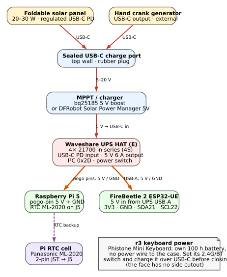
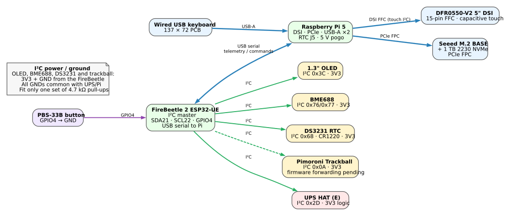
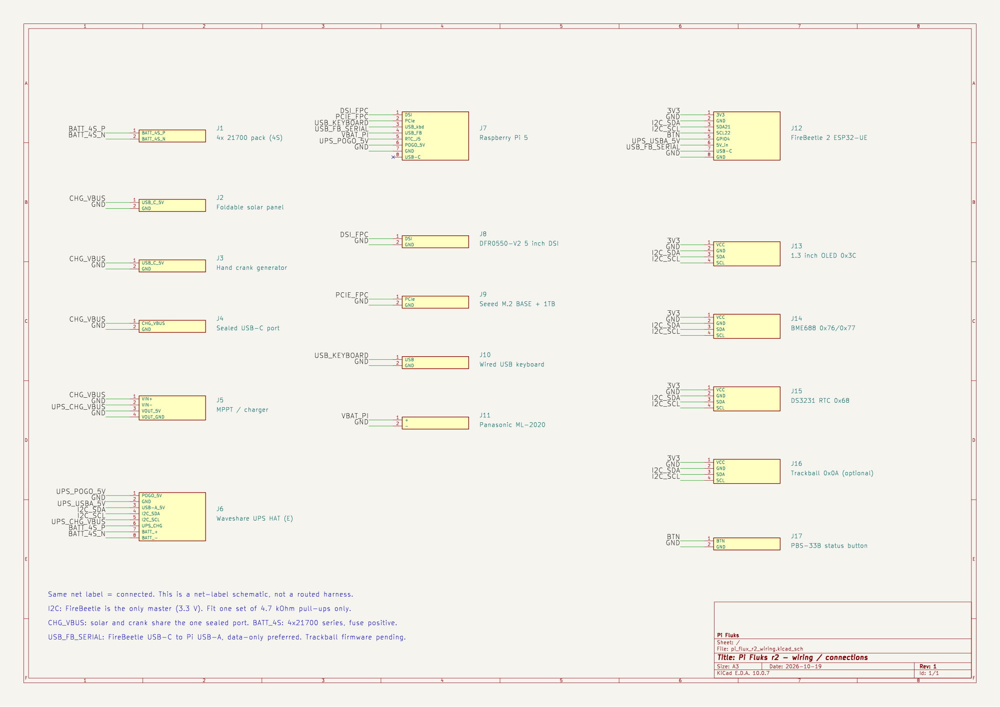

# Pi Fluks r2 — wiring / connection diagram

Two block diagrams: **power** and **data/I²C/USB**, plus an editable **KiCad 10 schematic** and a
netlist-style CSV. The block diagrams are generated from [`wiring_power.dot`](wiring_power.dot) and
[`wiring_data.dot`](wiring_data.dot); the PNG versions are next to the SVGs.

> The single I²C master is the **FireBeetle 2 ESP32-UE**. The Pi 5 has **no I²C connection** in this build
> (no 40-pin header); the BME688, DS3231, OLED and UPS fuel gauge sit on the FireBeetle bus. The Pimoroni
> trackball is an **r2-only optional** device (0x0A, firmware forwarding pending); **r3 does not use it** —
> the Phistone keyboard's air mouse and the touchscreen provide pointer input.

---

## 1. Power distribution

*[PNG version](wiring_power.png)*

| Path | Connection | Notes |
|---|---|---|
| Solar / crank → case | USB-C → sealed panel port | Foldable 20–30 W panel with regulated USB-C PD, or a USB-C hand crank. One sealed port only. |
| Sealed port → charger | 5–20 V → MPPT/bq25185 input | Use a **true MPPT** module if you want maximum panel efficiency; the bq25185 is a small 5 V-boost/power-path alternative. |
| Charger → UPS | 5 V → UPS USB-C input | The UPS charges its 4S pack and powers the Pi simultaneously. |
| UPS → Pi | Pogo pins: 5 V + GND | No cable; the UPS HAT sits on the Pi component side. |
| UPS → FireBeetle | USB-A 5 V + GND → FireBeetle 5 V/GND | Keeps the status OLED alive when the Pi is off. |
| Pi → RTC cell | ML-2020 2-pin JST → Pi J5 | Enable `dtparam=rtc_bbat_vchg=3000000`. |

**Bench charging:** a 27 W USB-C PD PSU gives the UPS its full fast-charge input only if it reaches the
UPS USB-C input directly. The sealed charge port is intended for solar/crank through the internal
charger, so expect slow charging through that path. Charge the UPS directly before final assembly.

---

## 2. Data, USB and I²C

*[PNG version](wiring_data.png)*

| Link | Cable / interface | Notes |
|---|---|---|
| Pi ↔ display | 15-pin DSI FFC (Pi 5 22-pin → 15-pin adapter) | DFR0550-V2; capacitive touch is carried on the DSI FFC on the standard version — verify your batch. |
| Pi ↔ NVMe | PCIe FPC → Seeed M.2 BASE → 1 TB 2230 NVMe | BASE is back-mounted under the Pi; check the 5 mm display/Pi gap. |
| Keyboard → Pi | USB-A | Wired USB keyboard only. |
| FireBeetle ↔ Pi | USB-C → Pi USB-A, **serial** | Telemetry/commands. Prefer a **data-only** cable (VBUS disconnected) because the FireBeetle is separately powered from the UPS. |
| FireBeetle → OLED | I²C: SDA GPIO21 / SCL GPIO22, 3V3, GND | 0x3C; 1.3" 128×64, SH1106 default. |
| FireBeetle → BME688 | I²C, 3V3, GND | 0x76 or 0x77. |
| FireBeetle → DS3231 | I²C, 3V3, GND | 0x68; CR1220 backup cell. |
| FireBeetle → trackball | I²C, 3V3, GND | **r2 only, optional**; 0x0A, firmware forwarding pending. Not fitted in r3. |
| FireBeetle → UPS HAT | I²C, GND | 0x2D fuel gauge; UPS I²C logic is 3.3 V. Do **not** also connect to the Pi. |
| Button → FireBeetle | GPIO4 → GND | PBS-33B momentary NO; firmware uses `INPUT_PULLUP`. |

> **r3 keyboard option:** the **Phistone Mini Keyboard** can use its 2.4 GHz USB-A dongle (same `USB_KEYBOARD` link) or Bluetooth (no cable; enable the Pi's Bluetooth and pair). The wiring above is the r2 wired USB keyboard. The FireBeetle radios stay off either way.

---

## 3. Pin-level connection tables

### FireBeetle 2 ESP32-UE (DFR1140)

| FireBeetle | Net | Goes to |
|---|---|---|
| `3V3` | `3V3` | OLED VCC, BME688 VCC, DS3231 VCC, trackball VCC (r2 optional) |
| `GND` | `GND` | Common ground: OLED, BME688, DS3231, trackball (r2 optional), UPS I²C GND, button, UPS USB-A GND |
| `GPIO21` / `SDA` | `I2C_SDA` | OLED SDA, BME688 SDA, DS3231 SDA, trackball SDA (r2 optional), UPS I²C SDA |
| `GPIO22` / `SCL` | `I2C_SCL` | OLED SCL, BME688 SCL, DS3231 SCL, trackball SCL (r2 optional), UPS I²C SCL |
| `GPIO4` | `BTN` | PBS-33B terminal 1; terminal 2 to GND |
| `5V` / `VCC` | `UPS_USBA_5V` | UPS HAT USB-A 5 V output |
| `USB-C` | `USB_FB_SERIAL` | Pi 5 USB-A (serial data; data-only preferred) |

### I²C modules

| Module | VCC | GND | SDA | SCL | Address |
|---|---|---|---|---|---|
| 1.3" OLED | 3V3 | GND | GPIO21 | GPIO22 | 0x3C (0x3D fallback) |
| BME688 | 3V3 | GND | GPIO21 | GPIO22 | 0x76 / 0x77 |
| DS3231 | 3V3 | GND | GPIO21 | GPIO22 | 0x68 |
| Pimoroni Trackball (r2 optional) | 3V3 | GND | GPIO21 | GPIO22 | 0x0A |
| UPS HAT (E) fuel gauge | — (from UPS) | GND | GPIO21 | GPIO22 | 0x2D |

### Raspberry Pi 5

| Pi 5 | Net / connection | Goes to |
|---|---|---|
| DSI | `DSI_FPC` | DFR0550-V2 15-pin DSI FFC |
| PCIe | `PCIE_FPC` | Seeed M.2 BASE |
| USB-A 1 | `USB_KEYBOARD` | Wired USB keyboard |
| USB-A 2 | `USB_FB_SERIAL` | FireBeetle USB-C (serial) |
| USB-C | — | Service/flashing only, not used in the case |
| J5 RTC | `VBAT_PI` | Panasonic ML-2020 2-pin JST |
| Pogo pad 5 V | `UPS_POGO_5V` | UPS HAT pogo 5 V |
| Pogo pad GND | `GND` | UPS HAT pogo GND |
| microSD | — | 32 GB card for initial boot/setup |

### Waveshare UPS HAT (E)

| UPS | Net | Goes to |
|---|---|---|
| Pogo 5 V | `UPS_POGO_5V` | Pi 5 5 V pogo pad |
| Pogo GND | `GND` | Pi 5 GND pogo pad |
| USB-C input | `UPS_CHG_VBUS` / `GND` | MPPT/charger 5 V output |
| USB-A output | `UPS_USBA_5V` / `GND` | FireBeetle 5 V/GND |
| I²C | `I2C_SDA` / `I2C_SCL` / `GND` | FireBeetle GPIO21/22/GND |
| V1–V4 | `BATT_4S` | 4× 21700 in series (matched, flat-top, unprotected; fuse the positive lead) |
| Power switch | — | Leave **ON**; the Pi is shut down in software |

### Sealed USB-C port → MPPT → UPS

| From | To | Notes |
|---|---|---|
| Sealed port outside | Solar panel or hand crank USB-C | One port, shared by both. |
| Sealed port inside (male pigtail) | MPPT/charger `VIN+` / `VIN−` | 5–20 V input. |
| MPPT/charger `VOUT 5V` / `GND` | UPS USB-C input `VBUS` / `GND` | 5 V, ≤1 A for the bq25185; a true MPPT module may give more. |

---

## 4. Wiring rules / checks

1. **Common ground everywhere.** The UPS, Pi, FireBeetle, sensors, OLED, keyboard and charge port must share
   GND. Use one star point at the UPS HAT and keep the 4S pack wiring short.
2. **Only one I²C master.** The FireBeetle owns the bus. Do not also connect the UPS, BME688, DS3231 or OLED
   to the Pi. Two masters on one bus will corrupt traffic.
3. **Pull-ups:** BME688, DS3231, OLED and UPS breakouts often each fit 4.7–10 kΩ pull-ups. In parallel they
   can overload the bus. Keep **one** set (or remove the extra resistors); check with a meter before powering.
4. **3.3 V only** on the I²C modules. The UPS I²C logic is 3.3 V; the FireBeetle is 3.3 V. Do not power the
   OLED/BME688/DS3231 from 5 V.
5. **FireBeetle power vs USB:** the FireBeetle is powered from UPS USB-A 5 V so the OLED works with the Pi
   off. The USB-C link to the Pi is for serial data; use a data-only cable or disconnect VBUS to avoid
   backfeeding the Pi USB port when the Pi is off.
6. **Display FFC:** the Pi 5 DSI connector is 22-pin; the DFR0550 is 15-pin. Use the Pi 5 Standard–Mini
   adapter cable. The DFR0550 listing currently warns about Pi 5 compatibility — verify the driver before
   closing the case.
7. **Battery pack:** 4S = 14.4 V nominal / 16.8 V full. Use matched cells, insulation rings, a fuse in the
   positive lead, and verify the V1–V4 order before connecting. Never assemble the pack with the UPS
   switched on.
8. **Buttons/switches:** the PBS-33B is not IP-rated; fit a 12 mm rubber boot. The UPS power switch stays on;
   the Pi is shut down via software. The status button is GPIO4 to GND.
9. **NVMe:** the Seeed M.2 BASE is back-mounted; check its height plus the 2230 SSD against the 5 mm
   display/Pi standoff before final assembly.
10. **First power-up:** leave the Pi disconnected, connect the UPS with a current-limited/bench supply,
    check 5 V rails and I²C addresses, then connect the Pi and display.

---

## 5. KiCad schematic

A KiCad 10 schematic is included: [`pi_flux_r2_wiring.kicad_sch`](pi_flux_r2_wiring.kicad_sch)
([PDF](pi_flux_r2_wiring.pdf), [SVG](kicad_wiring/pi_flux_r2_wiring.svg), [PNG](pi_flux_r2_wiring.png)).

It is a **net-label schematic**: every module is a connector-shaped block with named pins, and a short wire
plus a net label carries each signal. **Same net label = connected** — there are no routed harness lines.
This keeps the connection list readable and editable; use the two block diagrams above for the physical
topology. `pi_flux_r2_wiring.kicad_sch` opens directly in KiCad 10. ERC reports only `lib_symbol_issues`
for the embedded `PiFlux` symbols (they are not in an external library); there are no electrical errors.

The CSV [`pi_flux_r2_connections.csv`](pi_flux_r2_connections.csv) lists every net with `From`, `From pin`,
`To`, `To pin`, and cable/notes for a spreadsheet or for re-drawing the schematic by hand.
