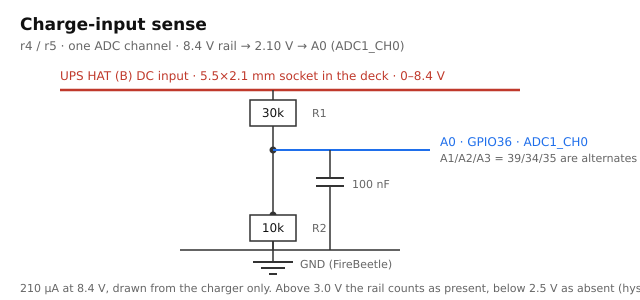

# Ktemata r5 — wiring / connections

The r5 build is an internal cassette that drops into a bought hard case: one external input (8.4 V), one
I²C master (the FireBeetle), and no cable to the keyboard. This page is the r5 netlist. Design notes are in
[`R5.md`](R5.md), parts in [`BOM.md`](BOM.md), energy in [`POWER.md`](POWER.md).

---

## 1. Power distribution

| Path | Connection | Notes |
|---|---|---|
| 8.4 V source → deck | mains PSU, **MPPT solar** or crank converter, 8.4 V / 2 A → **DC-099** panel jack | One input for all three. A USB-C PD panel cannot feed this: the HAT's input is 8.4 V DC. |
| DC-099 → HAT (B) | jack **centre +**, **shell −** → HAT 8.4 V barrel jack | **Centre-positive** — meter both jacks before the first plug. A 2 A fuse in this lead is optional; the pack fuse does not cover the input. |
| 16 mm latching switch | in the **8.4 V lead**, or a ≥5 A latching switch in the 5 V pair | The fitted ABS16CG11ZCB3V is rated **3 A / 24 V DC**, which suits the 2 A input and does **not** suit the Pi rail (5 A spec, ≈2.8 A here). LED 3–6 V, 15 mA, built-in resistor, either polarity — feed it from **5 V**, not the 8.4 V rail. Latching = hard cut: shut the Pi down in software first. |
| Cells → HAT | 2× 18650 in **2S** in the HAT's own holders | Matched pair, insulation rings. |
| Pack **+** → HAT | **BLX-A 5 × 20 holder, 5 A fast-acting fuse** | In series in the positive lead, before the HAT: the only protection the cells and pack wiring have. 5 A is 40–75 % of this build's draw. |
| HAT (B) **5 V / GND** → Pi 5 | soldered pair, **20–22 AWG**, short | Pi header pins **2/4** (5 V) and **6/9** (GND), or the underside pads. This is the Pi's only supply. |
| HAT (B) **USB-A 5 V / GND** → FireBeetle | 2-wire lead to `5V` / `GND` | Keeps the status OLED alive with the Pi off. |
| Charge rail → FireBeetle | `R1` 30k / `R2` 10k divider → `A0` (ADC1) | Sense tap on the HAT's DC input — see below. |
| Pi → RTC cell | ML-2020 2-pin JST → Pi **J5** | `dtparam=rtc_bbat_vchg=3000000` (rechargeable cell only). |
| Keyboard power | none | The Rii K06 has its own cell and charges over its USB port. In r5 it lifts out of the deck recess, so charge it outside the case. |

**Bench charging:** the HAT charges from its 8.4 V input only; a USB-C supply cannot reach it. Charge the
pack before final assembly, or through the deck's DC-099 with the lid open.

### Charge-input sense

The HAT (B)'s INA219 sits on the **pack** branch, so pack current alone cannot say whether a source is
connected — a full pack on a charger reads near zero. One ADC channel taps the DC input instead, so the
status OLED and the telemetry can answer "on battery, on external, or external too weak to carry the load"
without waiting for current to flow.

| | |
|---|---|
| Divider | `R1` 30k rail → pin, `R2` 10k pin → GND, `C1` 100 nF across `R2` |
| Scale | `(R1 + R2) / R2` = 4.0, so 8.4 V reads 2.10 V — the middle of the ADC's 11 dB range |
| Pin | `A0` / GPIO36 (`ADC1_CH0`); `A1`/`A2`/`A3` = 39/34/35 are the alternates, `-DPIN_CHG_SENSE=<gpio>` overrides |
| Load | 210 µA at 8.4 V, taken from the charger. With the rail dead the divider sees 0 V and the pack is untouched |
| Thresholds | present above **3.0 V**, absent below **2.5 V** (hysteresis); "steady" when the spread over 12 samples (60 s) is within **4 %** of the median |

**What it can and cannot tell.** Present/absent and steady/varying are measured. **Mains vs solar vs crank
is not** — all three arrive on the same socket and a voltage cannot distinguish them; the OLED and the JSON
therefore say `steady` / `varying` (and `external` / `external-weak`) and never claim a source type.

---

## 2. Data, USB and I²C

| Link | Cable / interface | Notes |
|---|---|---|
| Pi ↔ display | 22→15-pin **DSI FFC** + **3-pin GPIO power cable** | The lid cover carries the **Touch Display 2, 5"**: GPIO **J1 → pins 2 (5 V) and 6 (GND)**, and the panel is auto-detected — no overlay. Nothing else is wired to it. |
| *7" cover alternative* | 22→15-pin DSI FFC + its 4-pin `GND SDA SCL 5V` lead | Only for `ktemata_r5_lid_cover_waveshare_7in`: solder the four wires to Pi pads 6, 3 (GPIO2/SDA), 5 (GPIO3/SCL) and 2/4 (5 V) and add `dtoverlay=vc4-kms-dsi-waveshare-panel,7_0_inchC,i2c1`. |
| Pi ↔ NVMe | PCIe FPC → **Seeed M.2 BASE** → WD SN740 (M.2 2242) | The BASE is back-mounted; check the ≈10 mm stack against the tray before assembly ([`BOM.md`](BOM.md) note 7). |
| FireBeetle ↔ Pi | **USB-C → Pi USB-A, serial** | Newline-delimited JSON: telemetry out, commands in. Prefer a **data-only** cable (VBUS cut) — the FireBeetle is powered from the HAT. |
| FireBeetle → OLED | I²C `3V3`, `GND`, SDA GPIO21, SCL GPIO22 | **0x3C** (0x3D fallback), 1.3" 128×64, SH1106 by default. |
| FireBeetle → DS3231 | I²C `3V3`, `GND`, GPIO21, GPIO22 | **0x68**, CR1220 backup. |
| FireBeetle → HAT (B) gauge | I²C `GND`, GPIO21, GPIO22 — **logic is 3.3 V** | **0x42** INA219: pack V/I/W. Do **not** also connect this bus to the Pi. |
| OLED button → FireBeetle | **GPIO4 → GND** | PBS-33B momentary NO in the deck (`R5_OLED_BTN_*`), `INPUT_PULLUP`: short press next screen, long press acknowledge. |
| Keyboard → Pi | 2.4 GHz USB-A dongle in a Pi USB-A, **or** Pi Bluetooth | The K06 has no cable. Bluetooth needs the Pi's BT enabled and a wired keyboard for recovery; Wi-Fi stays off. |

---

## 3. Pin-level connection tables

### FireBeetle 2 ESP32-UE (DFR1140)

| FireBeetle | Net | Goes to |
|---|---|---|
| `3V3` | `3V3` | OLED VCC, DS3231 VCC |
| `GND` | `GND` | Common ground: OLED, DS3231, HAT I²C GND, OLED button, HAT USB-A GND, charge-sense divider |
| `GPIO21` / `SDA` | `I2C_SDA` | OLED SDA, DS3231 SDA, HAT I²C SDA |
| `GPIO22` / `SCL` | `I2C_SCL` | OLED SCL, DS3231 SCL, HAT I²C SCL |
| `GPIO4` | `BTN` | PBS-33B terminal 1; terminal 2 to GND. Fitted at `R5_OLED_BTN_*`, so `AUTO_CYCLE_MS=0UL` and `SCREEN_OFF_MS=60000UL` |
| `A0` / `GPIO36` | `CHG_SENSE` | 30k from the 8.4 V rail, 10k to GND, 100 nF across the 10k. ADC1_CH0 |
| `5V` / `VCC` | `UPS_USBA_5V` | HAT (B) USB-A 5 V output |
| `USB-C` | `USB_FB_SERIAL` | Pi 5 USB-A (serial; data-only cable preferred) |

### I²C modules

| Module | VCC | GND | SDA | SCL | Address |
|---|---|---|---|---|---|
| 1.3" OLED | 3V3 | GND | GPIO21 | GPIO22 | 0x3C (0x3D fallback) |
| DS3231 | 3V3 | GND | GPIO21 | GPIO22 | 0x68 |
| UPS HAT (B) INA219 | — (from the HAT) | GND | GPIO21 | GPIO22 | 0x42 |

### Raspberry Pi 5

| Pi 5 | Net / connection | Goes to |
|---|---|---|
| DSI | `DSI_FPC` | Touch Display 2 FFC (22→15-pin adapter) |
| GPIO pin 2 / 4 | `5V` | HAT (B) 5 V out — soldered, 20–22 AWG |
| GPIO pin 6 / 9 | `GND` | HAT (B) GND |
| GPIO J1 pin 2 / 6 | `DISP_5V` / `GND` | Display 3-pin power cable |
| PCIe | `PCIE_FPC` | Seeed M.2 BASE |
| USB-A 1 | `USB_KEYBOARD` | K06 2.4 GHz dongle (Bluetooth alternative uses no port) |
| USB-A 2 | `USB_FB_SERIAL` | FireBeetle USB-C (serial) |
| USB-C | — | Service/flashing and bench power only; not used with the HAT connected |
| J5 | `VBAT_PI` | Panasonic ML-2020 2-pin JST |
| microSD | — | card for the initial boot/setup |

### Waveshare UPS HAT (B)

| HAT | Net | Goes to |
|---|---|---|
| DC input (barrel) | `CHG_8V4` / `GND` | DC-099 panel jack in the deck, via the 16 mm switch |
| 5 V / GND pads | `UPS_5V` / `GND` | Pi 5 5 V / GND |
| USB-A output | `UPS_USBA_5V` / `GND` | FireBeetle `5V` / `GND` |
| I²C | `I2C_SDA` / `I2C_SCL` / `GND` | FireBeetle GPIO21 / GPIO22 / GND |
| Battery + / − | `BATT_2S` | 2× 18650 in its own holders, **5 A fuse in the + lead** |
| Gauge | — | INA219 at **0x42**; pack V/I/W only, no per-cell or capacity register |

### Deck panel parts

| Part | Net | Goes to |
|---|---|---|
| DC-099 centre pin | `CHG_8V4` | 16 mm switch → HAT DC input |
| DC-099 shell | `GND` | HAT DC input sleeve |
| 16 mm switch `C` | `CHG_8V4` (from the jack) | — |
| 16 mm switch `NO` | `CHG_8V4` (to the HAT) | Use NO + C, not NC |
| 16 mm switch `NC` | — | Unused; insulate the end. The 5-wire harness is `C`, `NO`, `NC`, `LED±`, but its colours change per batch — identify them with a meter (see note below) |
| 16 mm switch `LED+` / `LED−` | 5 V / GND | 3–6 V only, built-in resistor, ~15 mA; either polarity. Lights when the unit is on |
| PBS-33B terminal 1 / 2 | `GPIO4` / `GND` | FireBeetle |

---

## 4. Wiring rules / checks

1. **One ground node.** HAT, Pi, FireBeetle, OLED, DS3231, both buttons and the charge jack share GND. Star
   point at the HAT. The keyboard is the exception: it is wireless and has no electrical connection.
2. **One I²C master.** The FireBeetle owns the bus. Do not connect the HAT's I²C — or anything else on it —
   to the Pi.
3. **Pull-ups.** OLED, DS3231 and the HAT's INA219 may each carry 4.7–10 kΩ pull-ups; in parallel they load
   the bus. Keep **one** set and check with a meter before powering.
4. **3.3 V only** on the I²C modules and the HAT's I²C logic. Never power the OLED or DS3231 from 5 V.
5. **FireBeetle power vs USB.** Power comes from the HAT's USB-A so the OLED works with the Pi off; the
   USB-C link to the Pi is data only. Use a data-only cable, or cut VBUS, so the Pi's port is not backfed.
6. **Never feed the Pi twice.** With the HAT's 5 V soldered onto the Pi, do not plug a supply into the Pi's
   USB-C.
7. **Display.** The Touch Display 2 needs its 3-pin power cable (5 V on J1 pin 2, GND on pin 6) as well as the
   DSI FFC; it is auto-detected. Do not fit a `vc4-kms-dsi-…` overlay for it.
8. **Pack.** 2S = 7.4 V nominal, 8.4 V full. Matched cells, insulation rings, 5 A fuse in the positive lead,
   and never assemble or rewire the pack with the HAT powered.
9. **Buttons and switch.** The PBS-33B is not IP-rated — fit the 12 mm rubber boot. The 16 mm switch is
   **latching**: shut the Pi down in software, then cut. Its 5-wire harness colours are not standard:
   buzz it out before soldering — the wire that is common to the closed pair in **both** latch states is
   `C`, the partner closed with the button out is `NC`, the one closed with it in is `NO`, and the
   remaining two are the LED (either polarity, 3–6 V). Never put 8.4 V across the LED pair.
   FILN's harness FAQ gives **red = LED+, black = LED−, green = C, blue = NO, yellow = NC**; a
   **white** lead usually stands in for the blue `NO`. Treat that as a starting guess, not a spec.
10. **NVMe.** Check the M.2 BASE plus card stack against the tray before final assembly ([`BOM.md`](BOM.md)
    note 7).
11. **First power-up:** Pi disconnected. Feed 8.4 V and check the pack voltage, the fused + lead and the
    5 V / USB-A outputs; then the I²C scan should show `0x3C`, `0x42`, `0x68`; then connect the Pi and check
    `vcgencmd get_throttled` = `0x0`.
12. **Keyboard link.** 2.4 GHz dongle in a Pi USB-A, or Bluetooth with the Pi's radio enabled and a wired
    keyboard kept for first boot and recovery. Wi-Fi stays off; the FireBeetle radios stay off; the keyboard's
    own link is the single allowed radio exception.
